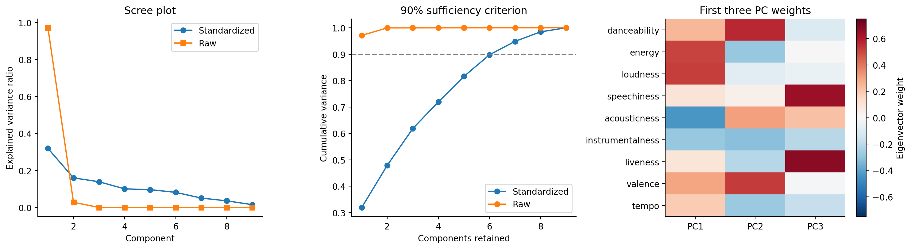
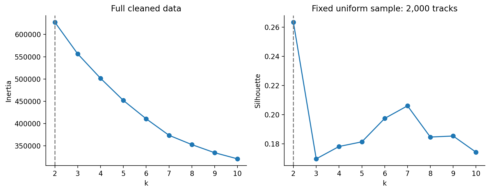
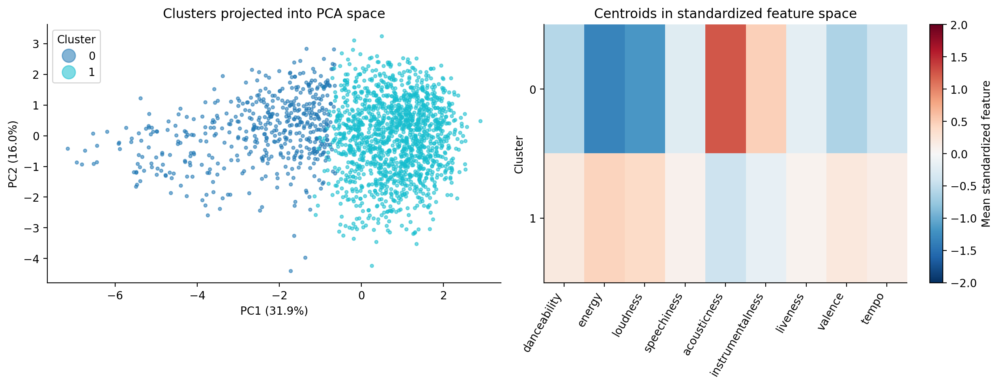
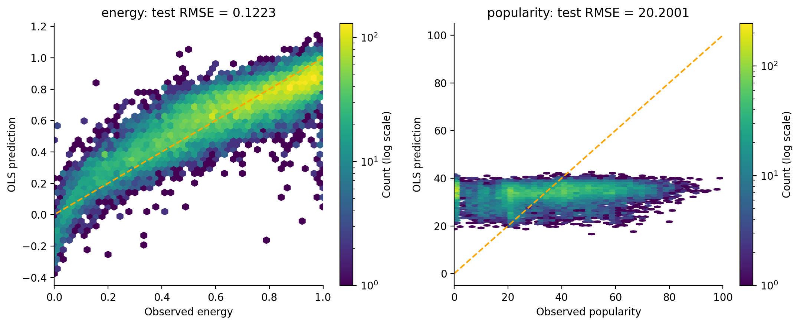
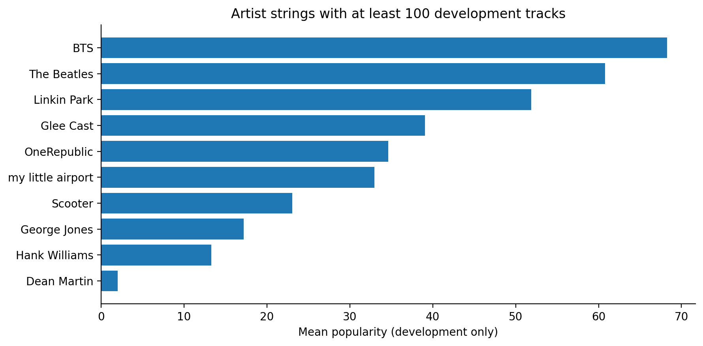
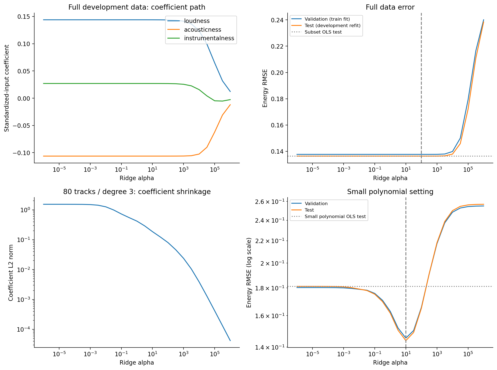

# HW1：音樂目錄的探索分析

學號：113062273

## 1／2. 分析範圍與預先登記的比較

本分析只使用作業提供的 tracks.csv，共 114,000 筆、20 欄。每列是歌曲與曲風的 listing，而不是必然不同的一首歌。研究重點是資料是否可靠、音訊特徵如何變動，以及 energy 和 popularity 能否由允許的音訊特徵預測，而非追求最高分數。

既有 pre-report 的兩個預測及否定條件維持原文意思，不依結果重寫。第一個預測是 energy 與 loudness 正相關、與 acousticness 負相關；接近零或反向會不支持預測。清理後 Pearson r 分別為 0.7594、-0.7353，Spearman r 為 0.7532、-0.7144，方向一致，支持這項描述性的預期，並不表示因果關係。

第二個預測是曲風在音訊特徵上有差異，相近性質的曲風 profile 可能接近。曲風間變異占比 eta-squared 在 acousticness 為 0.4883、energy 為 0.4542、danceability 為 0.4080，但 tempo 僅為 0.0784。結果支持部分音訊特徵的曲風差異；第 5.1 節的廣大混合群顯示，不能進一步認為曲風會全部形成清楚、互斥的音樂類別。

| 預先登記的項目 | 原先預測 | 後續使用的證據 |
| --- | --- | --- |
| energy held-out RMSE | 0.12，其他音訊特徵可能有預測資訊 | 第 6.1 節 OLS RMSE 0.1223 |
| popularity held-out RMSE | 18，可能受到資料未記錄的因素影響 | 第 6.1 節 OLS RMSE 20.2001 |
| 資料品質問題 | 相同歌曲可能出現在多個曲風與不同切分 | 第 3 節重複 ID 及錄音群組稽核 |
| 資料收集問題 | popularity 定義、時間範圍、同曲不同列是否一致 | 第 3、6.3 節衝突值與資料可回答的界線 |

## 共通方法與資料單位

Sections 4 至 6 使用清理後的 88,858 個唯一 track_id，另保留 111,458 筆歌曲與曲風的 membership。PCA 與分群使用九項連續音訊特徵：danceability、energy、loudness、speechiness、acousticness、instrumentalness、liveness、valence、tempo。key、mode、time_signature 不直接作為歐氏座標；回歸則將三者 one-hot 編碼。

回歸以相同正規化歌手／歌名或完整音訊與音樂屬性相同的歌曲建立相連的錄音群組，共 80,147 組。同一組不跨切分。所有隨機程序使用學號 113062273 初始化。

| 切分 | 歌曲數 | 錄音群組數 | 用途 |
| --- | --- | --- | --- |
| Train | 56,931 | 51,293 | 選參數時的模型訓練 |
| Validation | 14,158 | 12,824 | 選 Ridge alpha |
| Development（前兩者合併） | 71,089 | 64,117 | OLS 與最終完整資料 Ridge 擬合 |
| Test | 17,769 | 16,030 | held-out 評估與描述性參數曲線 |

資料：expectation1_correlations.csv、expectation2_genre_eta_squared.csv、regression_split_sizes.csv。全文表格與圖的數值均可由 HW1_code_113062273.ipynb 重現。

<!-- pagebreak -->

# 3. 資料稽核：優先處理重複與衝突

## 優先 1：重複歌曲造成權重偏移與切分洩漏

原始資料有 89,741 個唯一 track_id，其中 16,641 個出現多次；最多一個 ID 出現 9 次。此外有 450 筆完整重複列。若直接逐列分 train/test，同一歌曲的相同音訊可能出現在兩邊；即使不做回歸，PCA 或 k-means 也會讓多曲風歌曲獲得較高權重。

決策是先刪完整重複列，再以歌曲為單位做幾何分析與回歸，將曲風保存在另張多標籤 membership 表。對不同 ID 的可能重發錄音，也採較保守的群組切分：清理後有 4,913 組包含多個 ID，合計 13,624 首，最大組有 45 首。切分斷言及獨立檢查確認相同歌手／歌名和完整音訊向量沒有跨集合。

取捨是結果改為對「目錄中的歌曲」加權，無法維持原始 listing 的出現頻率。相同歌手／歌名可能是不同演奏；完整特徵相同也未必一定是同一錄音，因此群組規則可能過度合併，降低有效樣本數。反之，改名或音訊略變的重製版仍可能未被連結。這是降低已觀察到的洩漏風險，不是保證完全識別所有錄音。

## 優先 2：相同 ID 的 popularity 不一致

有 720 個 ID 的 popularity 不一致，但檢查的音訊特徵、key、mode、time_signature 與 duration_ms 在相同 ID 內均沒有衝突。例如 ID 5hljqZrl0h7RcIhUnOPuve 的 popularity 從 0 到 44；02jLfqc9gMo8PkHEGHY3OT 在不同列為 82 與 83。這表示既有 pre-report 中「同一首歌不同曲風的 popularity 是否相同」的問題，答案至少在這份目錄中不是一定相同。

任取第一列會讓目標取決於檔案順序，取平均則建立了一個原資料未定義的新目標。沒有量測時間或可信度欄位，無法判斷哪一列正確。決策是排除全部 720 個衝突 ID，讓所有後續分析使用一致的歌曲集合；清理流程因此移除 1,928 筆當時仍保留的 listings。

取捨是失去部分歌曲、曲風覆蓋與可能真實的時間變化。若衝突集中於特定曲風或 popularity 區段，刪除也可能引入選擇偏差。觀察到衝突不能證明 0 是缺值，也不能證明資料源錯誤或同一時間評分，因此其他合法的 popularity=0 仍保留。

## 為何重複／洩漏排在衝突之前？

重複 ID 影響 16,641 首歌，會同時改變 PCA、分群權重與回歸評估；資料洩漏甚至可能讓 held-out 誤差失去新歌曲泛化的意義。popularity 衝突雖有明顯的目標可信度問題，範圍為 720 個 ID，且沒有觀察到音訊衝突，因此排在第二。排名依分析受到的影響與範圍，而不是只看紀錄是否看起來奇怪。

| 清理階段 | 剩餘列數 | 該步移除 |
| --- | --- | --- |
| 原始 listings | 114,000 | - |
| 刪完整重複列 | 113,550 | 450 |
| 刪不合法／未偵測值 | 113,386 | 164 |
| 刪衝突 ID | 111,458 | 1,928 |
| 每個 track_id 一筆 | 88,858 | 22,600（membership 另存） |

資料：audit_duplicate_distribution.csv、audit_conflicting_columns.csv、audit_popularity_by_id_spread.csv、audit_related_recording_groups.csv、cleaning_flow.csv。

<!-- pagebreak -->

# 3. 資料稽核（續）：量測、抽樣與欄位表示

## 優先 3：零 tempo、零拍號與不合法長度

原始資料有 157 列 tempo <= 0、163 列 time_signature=0，以及 1 列 duration_ms <= 0；這些問題重疊，聯集為 164 列，不能把三個數字相加當成移除筆數。其餘連續音訊欄位沒有缺值或非有限值，七項 0 至 1 的音訊分數沒有超出範圍，popularity 也沒有超出 0 至 100。

tempo=0 不代表可直接比較的每分鐘節拍速度，time_signature=0 也缺少可解釋的拍號意義。決策是刪除這些未偵測或不合法 listings，不以任意平均值補成有節奏的歌曲。保留合法但少見的拍號 1、3、5，以及合法的 instrumentalness=0 等分數。

取捨是可能移除真正的靜音、非節拍音樂或偵測器難以處理的錄音，使清理後資料偏向能偵測節奏的歌曲。這 164 列占比很小，但被刪除的音樂型態可能不具隨機性。不能將「通過值域檢查」等同於「所有特徵都量測正確」。

## 優先 4：曲風的配額式筆數與多重標籤

原始資料的 114 種曲風各有恰好 1,000 列。這種規整筆數符合依曲風配額收集的現象，但檔案沒有抽樣流程或母體權重，不能確認原因，更不能解讀為每種音樂在真實平台同樣常見。多曲風歌曲又會讓曲風群體共享同一首歌。

決策是保留曲風標籤做 profile 比較，同一曲風內每首歌只算一次；不把列數或清理後分群比例估計成音樂市場占比。跨曲風的 cluster 統計使用每首歌總和為 1 的 membership 權重。取捨是無法依未知抽樣機率做母體修正，profile 也只是此目錄的平均，並非曲風的完整定義。eta-squared 因群體重疊只作描述，不使用獨立樣本顯著性推論。

## 優先 5：文字 metadata 缺值

artists、album_name、track_name 各缺 1 列，其餘欄位沒有缺值。決策是保留有效音訊，缺少的文字填空字串；缺少完整歌手／歌名的歌曲不藉由空字串互相合併，仍保留個別 ID 的身分。取捨是該筆資料的藝人推論與錄音辨識較弱。問題範圍小，且文字不進入主要音訊回歸，所以排在上述問題之後。

## 優先 6：整數編碼不是等距音樂座標

key、mode、time_signature 都以整數儲存。key 的相鄰代碼或兩個拍號的數字差，不能直接等同於可解釋的音樂距離。決策是在 PCA／分群排除這三欄；回歸把它們 one-hot 編碼，而非強迫每增加 1 具有固定線性作用。

取捨是幾何分析不包含調性與拍號結構，one-hot 也沒有表達調性的循環或親近關係。本次不加入外部音樂資訊來建立額外距離。此表示問題容易修正且欄位值沒有不合法代碼；排名靠後不表示可以直接忽略。

所有清理決策已實作於 notebook。後續只在第 5.3 節明示的 listing 權重敏感度檢查，使用含重複歌曲的有效 listings；其餘使用清理後的唯一歌曲。

資料：audit_validity.csv、audit_missing.csv、audit_genre_counts_raw.csv、audit_musical_codes.csv、audit_priorities.csv。

<!-- pagebreak -->

# 4. PCA：維度與標準化的影響

以九項連續音訊特徵執行 PCA，主要準則為累積解釋至少 90% 變異。標準化後需要 7 個 PC，累積 94.86%；6 個 PC 只有 89.77%，不能將其四捨五入後宣稱已達 90%。80% 與 95% 門檻分別需要 5、8 個 PC。前兩個 PC 只解釋 47.93%，因此二維圖不能代表全部音訊幾何，也不適合直接據此丟棄其他方向。

| 主成分 | 解釋變異 | 主要正向權重 | 主要負向權重 | 可解釋的變動方向 |
| --- | --- | --- | --- | --- |
| PC1 | 31.94% | loudness 0.516；energy 0.508 | acousticness -0.438 | 較大聲／高能量與較原聲的差別 |
| PC2 | 15.99% | danceability 0.566；valence 0.526 | instrumentalness -0.314；tempo -0.280 | 可舞性與正向感受較高，相對較純器樂／快節奏 |
| PC3 | 13.93% | liveness 0.674；speechiness 0.643 | instrumentalness -0.206 | 現場感、口語／人聲相關分數的差別 |

這些命名描述 feature scores 的共同變動，不保證歌曲具有相應情緒、現場錄音身分或實際口語內容。PC2 的 energy 權重也為 -0.282，所以它不是 PC1 的另一個能量版本。PC 的整體正負號可以同時翻轉，不改變距離或變異；不能把符號本身視為音樂價值。

## 為何未標準化只需要一個 PC？

PCA 在單位長度方向 w 上最大化投影變異 w^T S w，其中 S 是中心化資料的共變異矩陣；PC1 的最大值是 S 的最大 eigenvalue。原尺度的 tempo 變異為 882.4921，占所有欄位變異總和的 96.9914%；loudness 為 26.9388，占 2.9607%，其餘欄位各遠小於 1%。因此 raw PC1 的 tempo 權重為 0.9992，解釋 97.1338%，已單獨超過 90%。

標準化以各欄位標準差除去單位大小，使每欄的樣本變異約為 1.000011；這個微小偏離 1 來自 StandardScaler 使用 ddof=0，而樣本共變異使用 ddof=1。PCA 仍最大化變異，但此時單位大小不再讓 BPM 壓過 0 至 1 的分數，主要方向改由特徵關聯決定。直接計算 w^T S w 與最大 eigenvalue 的結果相等。

未標準化的一維結果只表示能保留原始單位下的數值變異，不表示音樂只有一個有效方向。標準化比較適合本次跨不同尺度的音訊結構問題，但同樣是將各欄初始尺度視為同等重要的選擇，並非唯一正確的音樂距離。

資料：pca_dimensions.csv、pca_variance.csv、pca_loadings_standardized.csv、pca_loadings_raw.csv、pca_feature_variance.csv、pca_variance_objective_check.csv。

<!-- pagebreak -->

# 5.1 曲風的階層式分群

每種曲風先將清理後唯一成員的九項音訊取平均，再使用歌曲層級的平均與標準差標準化 profile，讓曲風與歌曲有共同座標尺度。比較 Euclidean（平方差較重視大差異）與 city-block（各欄絕對差之和）；average linkage 使用群間平均距離，complete linkage 使用最遠成員距離。固定切成 8 群只是比較四種設定，不宣稱真實曲風應有 8 類。

| 距離／linkage | Cophenetic r | 同距離 silhouette | 共用 Euclidean silhouette |
| --- | --- | --- | --- |
| Euclidean／average | 0.8655 | 0.2634 | 0.2634 |
| Euclidean／complete | 0.7485 | 0.2079 | 0.2079 |
| City-block／average | 0.8270 | 0.2357 | 0.2387 |
| City-block／complete | 0.7267 | 0.2217 | 0.2032 |

Euclidean／average 對其原始距離的樹狀保真度最好，也在共用 Euclidean 評估下得到最高 silhouette，因此將它作為主要的音訊 profile 概括。不同距離的 silhouette 不能只憑數字直接當成相同的評分；共用距離欄位提供額外的對照。下表各群分數為群內曲風 profile 等權平均。樹圖、完整 membership 與各群 profile 均保存在 notebook／CSV。

| 主要設定的群 | 曲風數／例子 | Energy | Acousticness | Instrumentalness |
| --- | --- | --- | --- | --- |
| G1 | 3：black-metal、death-metal、grindcore | 0.910 | 0.014 | 0.418 |
| G2 | 94：pop、house、hip-hop、metal 等 | 0.668 | 0.282 | 0.081 |
| G3 | 4：techno、minimal-techno 等 | 0.718 | 0.063 | 0.618 |
| G4 | 2：idm、study | 0.483 | 0.454 | 0.732 |
| G5 | 8：classical、ambient、opera 等 | 0.276 | 0.801 | 0.455 |
| G6 | 1：iranian | 0.546 | 0.411 | 0.591 |
| G7 | 1：sleep | 0.377 | 0.690 | 0.733 |
| G8 | 1：comedy | 0.700 | 0.726 | 0.001 |

G1 的高 energy／低 acousticness，與 G5 的低 energy／高 acousticness，有具體 profile 差異。G8 的 speechiness 0.756、liveness 0.662，而 G7 的 loudness -24.535 dB、valence 0.068，使它們在此特徵空間突出。這些差異提供命名的依據，不需要借用外部曲風知識。

## 四種設定實際改變了什麼？

black-metal、death-metal、grindcore 在四種設定都同群，sleep 與 comedy 都維持單獨群。Euclidean／average 把 classical、ambient、opera 同群；city-block／average 把 opera 移入與 honky-tonk 等成員的群。Euclidean／complete 把廣大 G2 再分開：metal 與 heavy-metal 同群；pop、dance、house、hip-hop、country、bluegrass 在另一群；honky-tonk 又在另一群。群號僅在同一設定內有效。

同距離改 average 至 complete 的 ARI 在 Euclidean 為 0.3068、city-block 為 0.3554；固定 average 改距離的 ARI 為 0.7079。這次 linkage 對邊界的影響大於兩種距離在 average 下的差異。主要設定的 94 曲風大群也顯示它擅長描述離群方向，對細分大多數曲風卻有限；不能僅憑較高 silhouette 將這 94 種曲風宣稱為一致的音樂類別。

資料：genre_clustering_quality.csv、genre_quality_common_euclidean.csv、genre_group_members.csv、genre_group_profiles_euclidean_average.csv、genre_group_assignments.csv、genre_configuration_ari.csv。

<!-- pagebreak -->

# 5.2 個別歌曲分群與 k 的選擇

以完整 88,858 首清理歌曲的標準化音訊執行 k-means，k=2 至 10，每次 n_init=10。inertia 在完整資料計算；silhouette 使用同一批由固定 seed 均勻抽出的 2,000 首，避免不同 k 的樣本差異。silhouette 需要兩兩距離，使用子樣本降低計算成本，但樣本分數仍有抽樣變動。

| k | Inertia | Silhouette | 相對前一 k 的 inertia 降幅 |
| --- | --- | --- | --- |
| 2 | 627,300.1 | 0.2633 | - |
| 3 | 556,338.6 | 0.1697 | 11.31% |
| 4 | 501,470.8 | 0.1782 | 9.86% |
| 5 | 451,775.5 | 0.1814 | 9.91% |
| 6 | 410,514.9 | 0.1974 | 9.13% |
| 7 | 373,493.2 | 0.2061 | 9.02% |
| 8 | 352,584.2 | 0.1847 | 5.60% |
| 9 | 334,358.6 | 0.1854 | 5.17% |
| 10 | 320,584.2 | 0.1743 | 4.12% |

理論上的最小 inertia 隨 k 增加不會上升，本次擬合結果也逐步下降，但曲線沒有唯一明顯轉折；k=7 之後的相對改善縮小，可作較細分的候選，但 k=7 的 silhouette 仍低於 k=2。本次選 k=2，因為在已比較範圍得到最高 silhouette，也提供較易解釋的粗分。這是可重現的操作準則，不是對真正音樂類別數目的估計。

| 音訊特徵平均 | Cluster 0（22,301 首） | Cluster 1（66,557 首） |
| --- | --- | --- |
| danceability | 0.4635 | 0.5961 |
| energy | 0.2988 | 0.7476 |
| loudness（dB） | -14.4880 | -6.4712 |
| speechiness | 0.0594 | 0.0972 |
| acousticness | 0.7500 | 0.1874 |
| instrumentalness | 0.3251 | 0.1222 |
| liveness | 0.1795 | 0.2288 |
| valence | 0.3093 | 0.5238 |
| tempo（BPM） | 110.2413 | 126.2822 |

Cluster 0 可概括為較低能量、較安靜且原聲／器樂分數較高的歌曲；Cluster 1 平均能量與音量較高，可舞性、valence、tempo 也較高。群名依所有成員的特徵平均，不以曲風標籤命名，也不能把平均值套到每一首歌。

資料：kmeans_selection.csv、track_cluster_counts.csv、track_cluster_profiles_raw.csv。

<!-- pagebreak -->

# 5.3 群組是否有意義？證據與界線

## 證據一：與獨立 PCA 變動方向一致

群間差異主要沿 PC1：Cluster 0 偏向 PC1 的 acousticness 方向，Cluster 1 偏向 energy／loudness 方向，與第 4 節負荷解釋相符。這使群組能連結至可觀察音訊差異，並非僅報告 k-means 產生了兩個編號。然而 PCA 也使用同一份音訊，不是外部驗證；圖中有重疊與連續變化，且二維只含 47.93% 變異。圖支持粗略分區，不支持清晰的天然斷裂。

## 證據二：更換抽樣並重估尺度仍相近

從唯一歌曲另抽兩批各 20,000 首，分別重新 fit StandardScaler 和 k-means，再預測同一批完整 reference 歌曲。ARI 不受群編號交換影響；變動比例先用 Hungarian matching 對齊編號。

| 比較 | ARI | 對齊後歌曲 assignment 改變比例 |
| --- | --- | --- |
| 全資料 vs. 子樣本 1 | 0.9887 | 0.27% |
| 全資料 vs. 子樣本 2 | 0.9855 | 0.34% |
| 子樣本 1 vs. 子樣本 2 | 0.9750 | 0.59% |
| 唯一歌曲 vs. 有效 listing 權重 | 0.9487 | 1.23% |

兩個子樣本的結果非常接近，降低「某一次抽樣造成群組」的疑慮。最後一列故意使用 111,458 筆有效 listings，重新 fit 尺度與模型，讓多曲風歌曲獲得較大權重，再預測同一批唯一歌曲。變動較大但仍小，顯示本次粗分不完全依賴重複 listing；它不是未清理 114,000 列的模型比較。

## 證據三：未輸入曲風，仍有跨曲風的音訊關聯

分群完全未使用 track_genre，且每個 track_id 只保留一個座標。每首歌的多曲風 membership 分配總權重 1。new-age 與 sleep 的加權 membership 分別有 90.73%、96.16% 落在 Cluster 0；heavy-metal、drum-and-bass 分別有 98.11%、99.58% 落在 Cluster 1，與各群平均能量／原聲分數一致。

另一方面，Cluster 0 最大單一曲風的 membership share 只有 3.79%，Cluster 1 只有 1.46%，每群涵蓋多種曲風，不是單一曲風代碼的複製。但兩種最大 share 的量級也受原始曲風配額與權重設計影響，不能當母體多樣性指標。

三項證據共同支持穩定而可解釋的音訊粗分；它們不證明音樂天然分成兩群，也不保證其他距離、非球形分群演算法或未收錄音樂會得到相同結果。k-means 本來就會切出 k 群，穩定的分割也可能出現在連續梯度上。因此將群組用作探索摘要，不把 cluster ID 當可信的真實類別標籤。

資料：pca_loadings_standardized.csv、cluster_stability.csv、cluster_top_genre_memberships.csv、genre_cluster_weighted_counts.csv。

<!-- pagebreak -->

# 6.1／6.2 兩個回歸目標：預測與實測

Q1／Q2 只使用 danceability、speechiness、acousticness、instrumentalness、liveness、valence、loudness、tempo、key、mode、time_signature；僅 popularity 模型再加入 energy。duration_ms、explicit、genre、artists 等都不進入這兩題。目標本身不作輸入，scaler 與 encoder 只 fit 對應 development 資料，OLS 與訓練平均值 baseline 使用相同 test set。

| 項目 | Energy | Popularity |
| --- | --- | --- |
| Pre-report RMSE 預測 | 0.1200 | 18.0000 |
| OLS test RMSE | 0.1223 | 20.2001 |
| 訓練平均值 baseline RMSE | 0.2569 | 20.4984 |
| 實測減原先預測 | +0.0023 | +2.2001 |
| 相對 baseline RMSE 降幅 | 52.39% | 1.46% |
| Test R-squared | 0.7733 | 0.0288 |
| OLS RMSE 的群組 bootstrap 95% 區間 | 0.1202 至 0.1246 | 19.9344 至 20.4475 |

energy 的預估接近實測，但結果不應改寫成原先預測完全正確；其 RMSE 是 0 至 1 的 energy score 單位。popularity 誤差以 0 至 100 的分數單位計，原先 18 的預估較樂觀。不同目標的 RMSE 數值不能直接比大小；baseline-relative 降幅與 R-squared 顯示，在此切分與線性模型下 energy 容易預測得多。

在 development 資料中，energy 與 loudness、acousticness 的 Pearson r 分別為 0.7591、-0.7336；兩者提供可用的線性資訊。popularity 與這兩欄僅為 0.0756、-0.0393，與 energy 為 0.0145；連續候選中較大的關聯是 instrumentalness 的 -0.1323，仍不強。圖中 popularity 預測集中於狹窄區間，對高分歌曲偏低估、低分歌曲偏高估，與接近平均 baseline 的表現一致。

這支持「現有音訊輸入對 energy 的線性預測力較強」，不是「popularity 不可能被任何模型預測」。Pearson r 可能漏掉非線性關係；本次也未比較非線性模型。資料未包含 popularity 的時間、計算公式或行銷因素，因此不能用未觀察因素直接解釋誤差來源。

95% 區間由 test 錄音群組整組重抽 500 次計算，保留群內相關性；它反映此已訓練模型在此抽樣下的 test 誤差變動，未涵蓋換訓練集、換收集機制或模型選擇的全部不確定性。預測沒有裁切至目標範圍，以評估原始 OLS；部分 energy 預測超出合法範圍是線性模型的限制。

資料：regression_results.csv、regression_target_correlations_development.csv、ols_coefficients_energy.csv、ols_coefficients_popularity.csv。

<!-- pagebreak -->

# 6.3 一個額外資訊欄位：artists

popularity 的音訊線性模型接近 baseline，因此 Q3 另外選用目錄已有的 artists 一欄。保留原始歌手字串，合作組合不拆開，不加入外部知名度或串流資料。以 development fit 的 one-hot encoder 將少於 5 筆的 categories 合併；音訊模型與音訊加 artists 模型都使用相同固定 alpha=10 的 Ridge、相同 development／test 切分。

| Test 子集合 | 歌曲數 | 僅音訊 RMSE | 音訊加 artists RMSE | RMSE 降幅 |
| --- | --- | --- | --- | --- |
| 全部歌曲 | 17,769 | 20.2002 | 17.8755 | 2.3247 |
| Development 見過相同 artist string | 12,668 | 19.9217 | 16.5363 | 3.3853 |
| 未見過相同 artist string | 5,101 | 20.8758 | 20.8323 | 0.0435 |

為避免把不同模型差異誤認為 artists 的效果，這裡用兩個同 alpha、同求解器的 Ridge 比較，而不是直接拿 artist Ridge 和上一節的 OLS 作增益估計。整體 RMSE 降低約 11.51%，支持 artists 在此目錄提供額外的預測資訊；其能力主要來自已見過的 artist strings。

圖中的 development 平均值差異，與 held-out 改善一起支持欄位選擇。但它只是示例，不代表藝人間的因果差異；每位藝人的歌曲收集方式、genre、發行版本或評分時間都可能不同。圖只顯示符合至少 100 首門檻的最高平均值十組，沒有涵蓋所有藝人。

未見過 artist string 的 5,101 首幾乎沒有改善，因此不能把整體 17.8755 推廣成新藝人的預期誤差。合作字串也可能被當成新 category，即使其中某位歌手出現過；低頻與未知 category 的合併讓模型較穩定，但失去細部身分資訊。錄音群組切分降低同曲重發的直接洩漏，仍允許同一藝人的其他歌曲出現在 development，這對「已知藝人的新歌曲」較有意義。

## 對 pre-report 資料收集問題的回應

同 ID 的 popularity 確實可能不一致，且去除這些 ID 是可靠目標的實作決策，不是解開其原因。資料沒有評分量測時間、發布時間、廣告或藝人知名度欄位；artists 的預測增益不能回答 popularity 是長期累積或近期熱度，也不能驗證其公式使用哪些因素。這些問題仍需要資料提供者的定義與時間紀錄，在本作業不以外部資料補答。

應用上的決策是：此目錄可探索音訊相似性與已知藝人的 popularity 關聯；若要預測新藝人或跨時間的 popularity，現有評估證據不足。不要將 artist category 的回歸係數解釋為藝人名氣本身或推薦排序的公平依據。

資料：additional_artist_information.csv、artist_popularity_development.csv；額外模型只出現在 Q3。

<!-- pagebreak -->

# 6.4 Energy 正則化與整體限制

Q4 選 loudness、acousticness、instrumentalness。Train 中 loudness 與後兩者的 Pearson r 為 -0.5832、-0.4347，但後兩者互相關只有 0.0945。這是以 loudness 連結的中度相關子集，不能稱三者皆高度共線。使用此子集是為觀察相關輸入的係數收縮；前一節完整音訊 OLS 的 0.1223 不是相同輸入的基準。

三欄先 standardize，再比較 alpha=1e-6 至 1e6 共 25 個 Ridge 設定。Ridge 最小化平方殘差和加 alpha 乘係數平方和，截距不受罰。alpha 由 validation RMSE 選擇後，完整線性版本用 development 重估；test 曲線只展示變化，不據此挑 alpha。

| 設定 | 訓練筆數／basis 數 | Validation 選的 alpha | 相同輸入 OLS test RMSE | Ridge test RMSE |
| --- | --- | --- | --- | --- |
| 完整 development、三個線性輸入 | 71,089／3 | 100 | 0.136381 | 0.136380 |
| 小樣本、三次多項式 | 80／19 | 10 | 0.181219 | 0.143941 |

完整資料 alpha 從 1e-6 增至 1e6，loudness 係數由 0.143925 降至 0.012350，acousticness 由 -0.106258 變 -0.011959，instrumentalness 由 0.027031 變 -0.002579。L2 norm 由 0.180931 降至 0.017383，但個別係數不一定單調縮向零，也可能變號。最強正則化 test RMSE 升至 0.238385，顯示收縮過度會失去訊號。選定 alpha=100 的改善只有約 0.00000093，沒有可主張的實質預測提升。

依規格另建立較容易看到作用的設定：從 train 抽 80 個不同錄音群組各一筆，三次多項式含 19 個 basis，展開後再 standardize。相同 80 筆擬合 OLS／Ridge，validation／test 皆不加入小樣本訓練。alpha=10 時 test RMSE 由 0.181219 降為 0.143941，約改善 20.57%，對應較大的估計變動被收縮；更大 alpha 最後使誤差接近平均值 baseline。

此示範在開發過程探索過更高階 polynomial，並曾檢視其 test 表現，詳見 AI-use log。因此小樣本結果是探索性示範，不視為事前固定設定的確認性改善；單一 80 筆樣本也不足以證明不同抽樣皆同幅改善。

綜合而言，此目錄提供可重現的音訊變動、穩定粗分與 energy 線性預測資訊；popularity 的音訊線性預測力弱，artists 的增益主要限於已見字串。重複、衝突、曲風配額、量測限制與未知時間定義，限制母體及跨時間外推。後續使用應先界定預測對象與評分時間，再驗證所需泛化情境。本次沒有用外部資料消除這些限制。

資料：regularization_selected_correlations_training.csv、ridge_full_path.csv、ridge_small_polynomial_path.csv、ridge_summary.csv、HW1_ai_use_113062273.md。程式與輸出雜湊／版本紀錄見 notebook 及 reproducibility.json。
