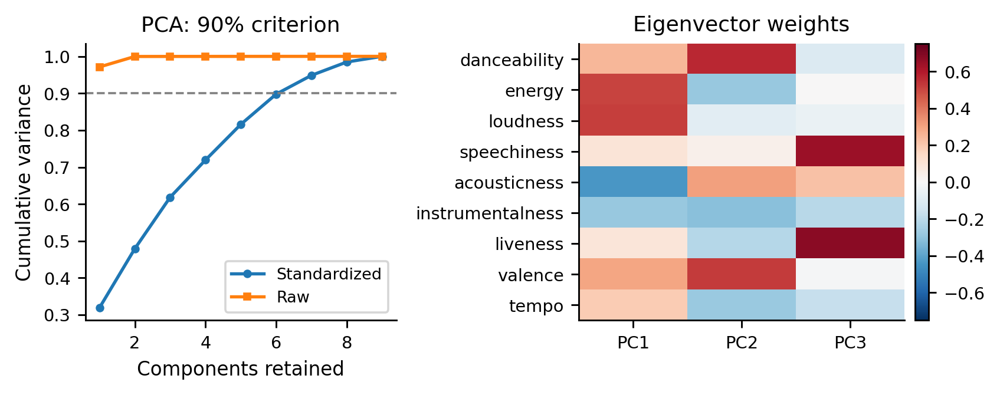
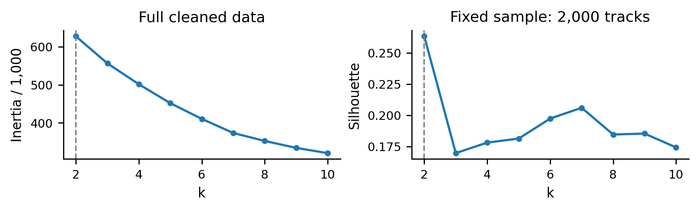
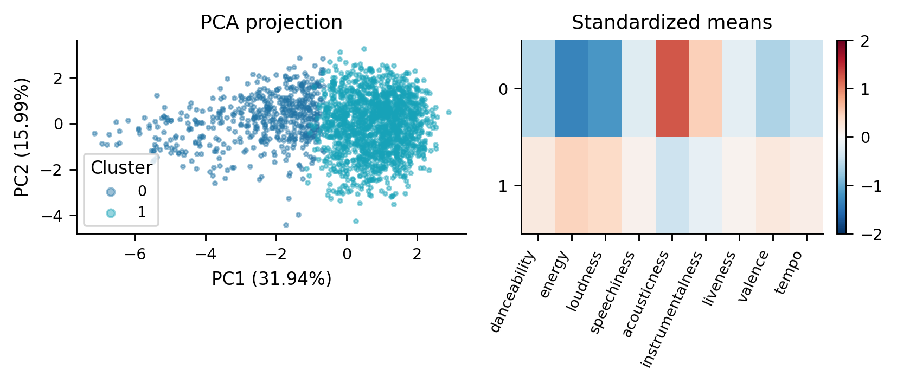
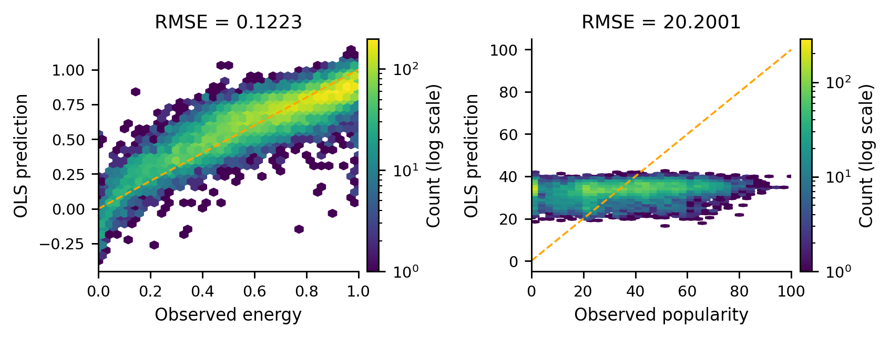
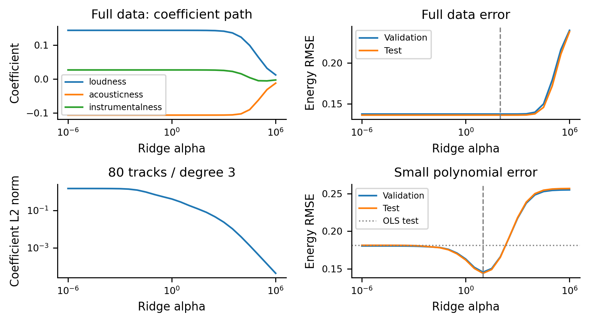

# HW1：音樂資料分析

學號：113062273

## 1／2. 資料與事前預測

本次只使用作業提供的 tracks.csv，共 114,000 列、20 欄。每列是歌曲與曲風的配對，不一定是不同歌曲。清理後以 88,858 個唯一 track_id 分析，另外保存 111,458 筆曲風配對。

事前預期 energy 與 loudness 正相關、與 acousticness 負相關；接近零或反向就不支持預期。實際 Pearson r 為 0.7594、−0.7353，方向符合預期。另一項預期是曲風有音訊差異、相近曲風可能接近；acousticness、energy 的曲風間變異占比分別為 0.4883、0.4542。第二項僅部分支持：雖有差異，後續也有大型混合群，不能說曲風都能清楚分開。

## 3. 六項資料品質問題與處理

以下依對後續分析的影響排序；每項都有證據、處理方式及取捨。

## 優先 1：重複歌曲

16,641 個 track_id 出現多次，另有 450 列完全重複。同曲若跨 train/test，可能使誤差看起來過低；重複列也會改變 PCA 與分群權重。因此先刪完整重複列，再每個 ID 留一筆，曲風標籤另存。回歸把相同歌手／歌名或完整音訊屬性相同的歌曲放在同一錄音群組。取捨是改以歌曲而非配對列加權，群組規則也可能合併不同演奏版本。

## 優先 2：同一 ID 的 popularity 不一致

720 個 ID 的 popularity 有衝突，但檢查的音訊欄位沒有衝突。任選一列會依賴檔案順序，取平均則改變目標定義。因此排除全部衝突 ID，共移除 1,928 筆仍有效的配對列。取捨是失去歌曲及可能真實的時間變化，也可能產生選擇偏差；其他合法的 popularity=0 保留。

## 優先 3：零 tempo、零拍號與不合法長度

tempo≤0 有 157 列、time_signature=0 有 163 列、duration_ms≤0 有 1 列，重疊後共 164 列。這些值無法直接當成正常節奏或長度，因此刪除，不任意補平均值。合法的少見拍號及零音訊分數保留。取捨是可能刪掉非節拍音樂或偵測困難的歌曲；通過值域檢查也不保證量測正確。

## 優先 4：曲風筆數規整且可能多重標籤

114 種曲風原本各有 1,000 列，不能當成平台的自然曲風比例。保留曲風做平均特徵比較，同曲在每種曲風只計一次；跨曲風統計讓每首歌的標籤權重合計為 1。取捨是缺少抽樣機率，無法推估母體比例；曲風間變異占比也只作描述。

## 優先 5：文字欄位缺值

artists、album_name、track_name 各缺 1 列。保留有效音訊，文字填空字串，缺歌手／歌名時不靠空字串合併歌曲。取捨是該筆的錄音辨識與藝人資訊較弱；範圍小，且文字不進入主要音訊回歸。

## 優先 6：整數代碼不等於音樂距離

key、mode、time_signature 三欄是整數編碼，代碼的差不能直接解讀為音樂差異。因此 PCA／分群排除這三欄，回歸使用 one-hot 編碼。取捨是幾何分析不含調性與拍號，one-hot 也不表達調性之間的關係。

重複排在衝突之前，是因為影響 16,641 首歌，且同時影響幾何分析與回歸評估；衝突影響 720 個 ID，主要是目標可信度問題。清理流程為 114,000 → 113,550 → 113,386 → 111,458 筆配對列，最後得到 88,858 首歌曲。以上決策均已實作在 notebook。

<!-- pagebreak -->

# 4. PCA 與 5.1 曲風分群

## PCA：需要幾個方向？

PCA 使用九項連續音訊特徵：danceability、energy、loudness、speechiness、acousticness、instrumentalness、liveness、valence、tempo。以累積解釋至少 90% 變異為準，標準化後需要 7 個 PC（94.86%）；6 個只有 89.77%。前兩個合計 47.93%，二維圖只代表部分資訊。

| 主成分 | 解釋變異 | 主要權重與解讀 |
| --- | --- | --- |
| PC1 | 31.94% | loudness 0.516、energy 0.508；acousticness −0.438。主要區分高能量／較大聲與較原聲。 |
| PC2 | 15.99% | danceability 0.566、valence 0.526；instrumentalness −0.314、tempo −0.280。描述可舞性、正向分數與器樂／節奏的共同變動。 |
| PC3 | 13.93% | liveness 0.674、speechiness 0.643；instrumentalness −0.206。主要是現場感與口語相關分數的變動。 |

PCA 最大化單位方向 w 的投影變異 wᵀSw，S 是共變異矩陣。原尺度 tempo 的變異為 882.4921，占總變異 96.99%，loudness 只有 26.9388；所以未標準化 PC1 幾乎就是 tempo（權重 0.9992），單獨解釋 97.13%，只需 1 個 PC 就達 90%。

標準化後，各欄變異約為 1，方向改由欄位之間的關係決定。本次使用標準化結果，避免單位大小主導距離；但這也代表給各欄相同初始尺度。PC 名稱只是特徵分數的解讀，不保證實際情緒或錄音身分；正負號整體翻轉也不改變結果。

## 曲風：比較兩種距離與兩種 linkage

每種曲風以清理後歌曲的九項音訊平均作 profile，再用歌曲層級的平均、標準差轉換尺度。比較 Euclidean 與 city-block 距離，以及 average 與 complete linkage，固定切成 8 群以便比較。average 看群間平均距離，complete 看最遠距離。

| 距離／linkage | Cophenetic r | 同距離 silhouette | 共用 Euclidean silhouette |
| --- | --- | --- | --- |
| Euclidean／average | 0.8655 | 0.2634 | 0.2634 |
| Euclidean／complete | 0.7485 | 0.2079 | 0.2079 |
| City-block／average | 0.8270 | 0.2357 | 0.2387 |
| City-block／complete | 0.7267 | 0.2217 | 0.2032 |

選 Euclidean／average，因為樹狀距離保真度及共用距離下的 silhouette 都較好。它把 black-metal、death-metal、grindcore 分在一起（平均 energy 0.910、acousticness 0.014），classical、ambient、opera 等在另一群（0.276、0.801），有可觀察的音訊差異。

改成 city-block／average，opera 移到 honky-tonk 等所在群；改成 Euclidean／complete，原本大群中的 metal、heavy-metal 與 pop、dance、house 等被分開。Euclidean 下改 linkage 的 ARI 為 0.3068，average 下改距離為 0.7079，顯示 linkage 對本次分群的影響較大。主要設定仍有 94 種曲風的大群，因此只作粗略摘要，不宣稱 8 群是真實曲風分類。完整樹圖及群成員見 notebook。

<!-- pagebreak -->

# 5.2 歌曲分群：選擇 k 與解讀

對全部 88,858 首歌曲的標準化音訊做 k-means，比較 k=2 至 10，每次 n_init=10。inertia 用完整資料；silhouette 用固定 seed 均勻抽出的同一批 2,000 首，降低兩兩距離的計算成本，仍有抽樣變動。隨機種子為 113062273。

inertia 從 k=2 的 627,300.1 降到 k=10 的 320,584.2，沒有唯一明顯轉折；k=7 之後降幅縮小，但 silhouette 在 k=2 最高（0.2633），k=7 為 0.2061。因此選 k=2 作容易解釋的粗分，不把它當成真正音樂類別的數量。

| 特徵平均 | Cluster 0（22,301 首） | Cluster 1（66,557 首） |
| --- | --- | --- |
| danceability | 0.4635 | 0.5961 |
| energy | 0.2988 | 0.7476 |
| loudness（dB） | −14.4880 | −6.4712 |
| speechiness | 0.0594 | 0.0972 |
| acousticness | 0.7500 | 0.1874 |
| instrumentalness | 0.3251 | 0.1222 |
| liveness | 0.1795 | 0.2288 |
| valence | 0.3093 | 0.5238 |
| tempo（BPM） | 110.2413 | 126.2822 |

Cluster 0 平均較安靜、低能量，原聲與器樂分數較高；Cluster 1 能量、音量、可舞性、valence 與 tempo 較高。這是整群平均，不表示每首歌都符合描述，也不是直接用曲風替群組命名。

<!-- pagebreak -->

# 5.3 分群是否有意義？三項證據

## 證據一：與 PCA 的主要變動方向一致

兩群主要沿 PC1 分開：Cluster 0 偏 acousticness，Cluster 1 偏 energy／loudness，符合 PCA 權重與群平均的解讀。但 PCA 也使用相同音訊，不是外部驗證；投影中有重疊，二維只保留 47.93% 變異，所以支持粗分，不能證明天然界線。

## 證據二：更換抽樣，結果仍接近

另外均勻抽兩批各 20,000 首，分別重估 StandardScaler 與 k-means，再對同一批完整歌曲預測。ARI 不受群號交換影響；變動比例先對齊群號。

| 比較 | ARI | 對齊後分群改變比例 |
| --- | --- | --- |
| 全資料 vs. 子樣本 1 | 0.9887 | 0.27% |
| 全資料 vs. 子樣本 2 | 0.9855 | 0.34% |
| 子樣本 1 vs. 子樣本 2 | 0.9750 | 0.59% |
| 唯一歌曲 vs. 有效配對列加權 | 0.9487 | 1.23% |

結果接近，降低單次抽樣造成分群的疑慮。最後一列特別用 111,458 筆有效配對列重估，讓多曲風歌曲權重較大，是本報告唯一使用重複歌曲列的敏感度檢查。變動仍小，但穩定不等於真實類別。

## 證據三：未輸入曲風，仍有可解釋的關聯

分群未使用 track_genre。每首歌的多曲風權重合計為 1；new-age、sleep 的加權標籤分別有 90.73%、96.16% 落在 Cluster 0，heavy-metal、drum-and-bass 有 98.11%、99.58% 落在 Cluster 1，與低／高能量方向一致。

每群仍含多種曲風：最大單一曲風占比只有 3.79%、1.46%，所以不是直接複製某個曲風。比例也受原始曲風配額影響，不能視為市場比例。三項證據支持穩定且可解釋的音訊粗分，但連續梯度也能被 k-means 切成群，因此把結果用作探索摘要。

<!-- pagebreak -->

# 6.1–6.3 回歸結果與額外資訊

## 共同切分與輸入

以 80,147 個錄音群組切分，同組不跨集合。Train 有 56,931 首，validation 有 14,158 首，test 有 17,769 首；OLS 使用前兩者合併的 development（71,089 首）訓練。標準化與編碼只 fit 訓練資料，所有模型用相同 test。

Q1／Q2 使用 danceability、speechiness、acousticness、instrumentalness、liveness、valence、loudness、tempo，以及 one-hot 的 key、mode、time_signature；popularity 再加入 energy。目標本身不作輸入，duration_ms、explicit、曲風與藝人不進入這兩題。

## 事前 RMSE、實際結果與 baseline

| 項目 | Energy | Popularity |
| --- | --- | --- |
| Pre-report 預測 RMSE | 0.1200 | 18.0000 |
| OLS test RMSE | 0.1223 | 20.2001 |
| 訓練平均值 baseline RMSE | 0.2569 | 20.4984 |
| 比 baseline 改善 | 52.39% | 1.46% |

energy 的實測接近事前預測，popularity 則比預估差 2.2001。兩者分別是 0–1、0–100 分數的誤差，不能直接比 RMSE 大小；與各自 baseline 比較後，energy 的線性預測力明顯較強。

development 中，energy 與 loudness、acousticness 的 r 為 0.7591、−0.7336；popularity 與兩者只有 0.0756、−0.0393，與 energy 為 0.0145。這支持音訊對 energy 較有線性資訊；popularity 預測集中在平均附近。相關不表示因果，也不能據此說任何模型都無法預測人氣。OLS 未裁切預測，部分 energy 會超出合法範圍。

## 額外欄位：artists

Q3 加入原始 artists 字串，使用訓練資料 fit 的 one-hot，少於 5 筆的類別合併；合作字串不拆開。兩個比較模型都用相同 alpha=10 的 Ridge，因此較能把改善歸因於額外欄位。

| Test 子集合 | 歌曲數 | 僅音訊 RMSE | 加 artists RMSE |
| --- | --- | --- | --- |
| 全部 | 17,769 | 20.2002 | 17.8755 |
| 訓練見過相同藝人字串 | 12,668 | 19.9217 | 16.5363 |
| 未見過相同藝人字串 | 5,101 | 20.8758 | 20.8323 |

整體改善 11.51%，但主要來自已見過的藝人字串，對陌生藝人幫助很小；不能把整體效果套到新藝人。這回答了 artists 是否提供預測資訊，但資料缺少評分時間與人氣計算公式，仍無法回答 pre-report 的人氣定義、時間範圍問題，也不能確定同 ID 衝突的原因。

<!-- pagebreak -->

# 6.4 正則化：有效在哪裡？

只用 Train 比較允許的八個連續輸入，共 28 組配對，最高 |r| 只有 0.5832。選 loudness、acousticness、instrumentalness，以 loudness 連接兩組較相關的配對（r=−0.5832、−0.4347）；後兩者 r=0.0945。這是包含最強配對的三欄子集，原始欄位本身缺少高度共線的組合。

三欄先標準化，比較 alpha=10⁻⁶ 至 10⁶ 的 25 個 Ridge 設定。Ridge 在平方誤差外加入 alpha 乘係數平方和，截距不受罰。先以 Train 擬合、用 validation RMSE 選 alpha；完整資料模型再以 development 重訓，test 曲線只展示，不用來挑 alpha。

| 設定 | 訓練筆數／basis 數 | Validation 選的 alpha | 同輸入 OLS test RMSE | Ridge test RMSE |
| --- | --- | --- | --- | --- |
| 完整資料、三個線性輸入 | 71,089／3 | 100 | 0.136381 | 0.136380 |
| 小樣本、三次多項式 | 80／19 | 10 | 0.181219 | 0.143941 |

完整資料中，alpha 由 10⁻⁶ 增至 10⁶，係數 L2 長度由 0.180931 降到 0.017383。loudness 係數由 0.143925 降到 0.012350，acousticness 由 −0.106258 到 −0.011959，instrumentalness 由 0.027031 到 −0.002579。整體收縮不代表每個係數都單調，也可能變號；最強正則化的 test RMSE 升到 0.238385，顯示過度收縮會失去訊號。

完整資料選出的 alpha=100 只改善約 0.00000093，沒有實質提升。樣本多、只有三個輸入，OLS 估計較穩，收縮的收益有限；比較基準是同輸入的 OLS 0.136381，不是前題完整音訊 OLS 的 0.1223。

依規格再從 Train 抽 80 個不同錄音群組各一首，展開三次多項式得到 19 個 basis，再標準化。OLS／Ridge 都只用相同 80 首訓練，validation／test 不加入訓練。alpha=10 時，test RMSE 從 0.181219 降至 0.143941，改善 20.57%。OLS 的訓練 RMSE 為 0.1181，Ridge 為 0.1459：收縮犧牲訓練配適，卻改善 test，符合小樣本、較多係數時降低過擬合的作用；alpha 過大又失去訊號。

這個設定也有實際的強相關基底。以標準化後的 L=loudness、I=instrumentalness 表示，L²、L³、L²I 三者的配對 |r| 為 0.9719、0.9671、0.9755，均只用這 80 首訓練資料計算。因此，較豐富的基底同時提供高度相關與小樣本的正則化示範。

單次抽樣也不保證每次都改善同樣幅度。

資料：全部數值、完整分群成員與圖表可由 HW1_code_113062273.ipynb 及 HW1_results_113062273 中的 CSV 重現。
