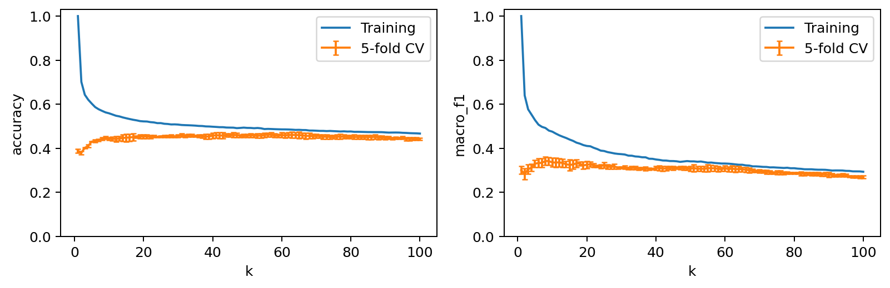
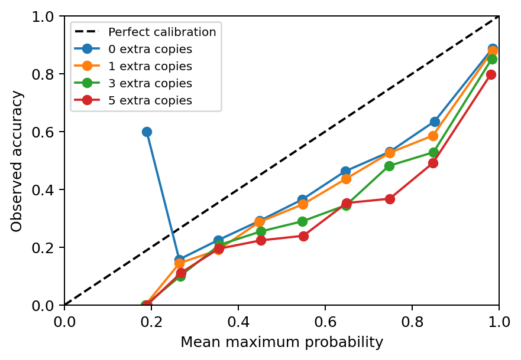
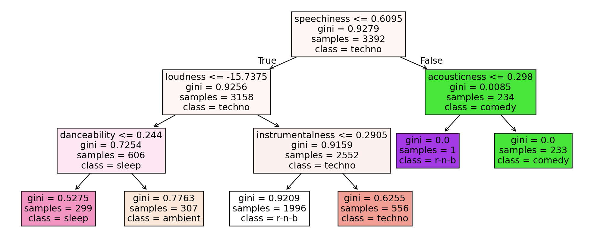
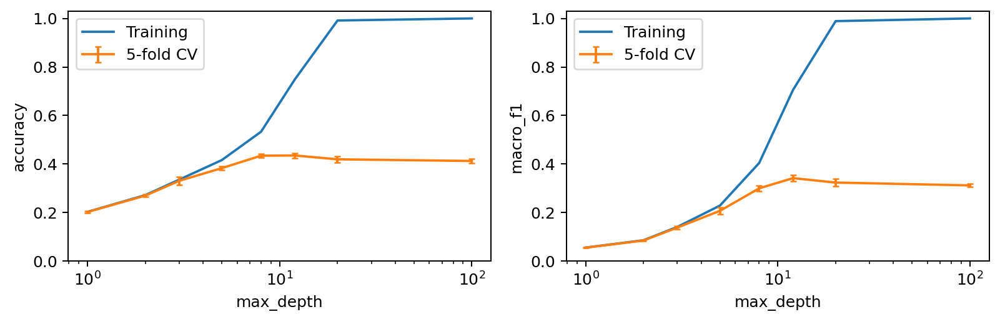
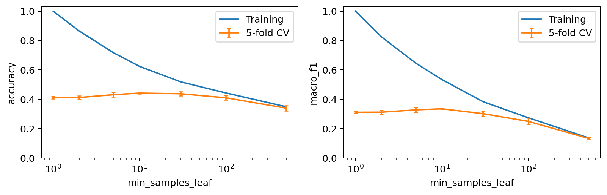
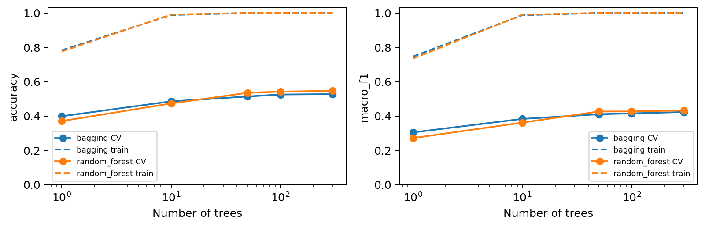
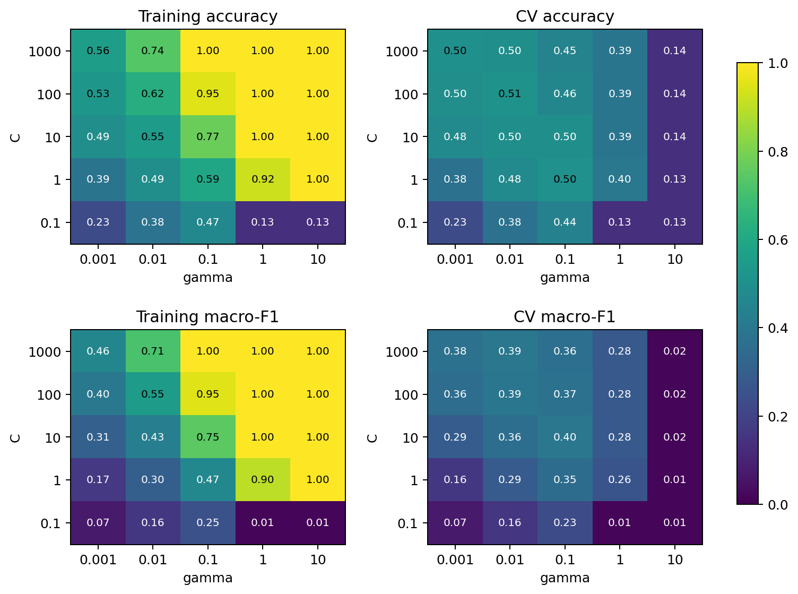
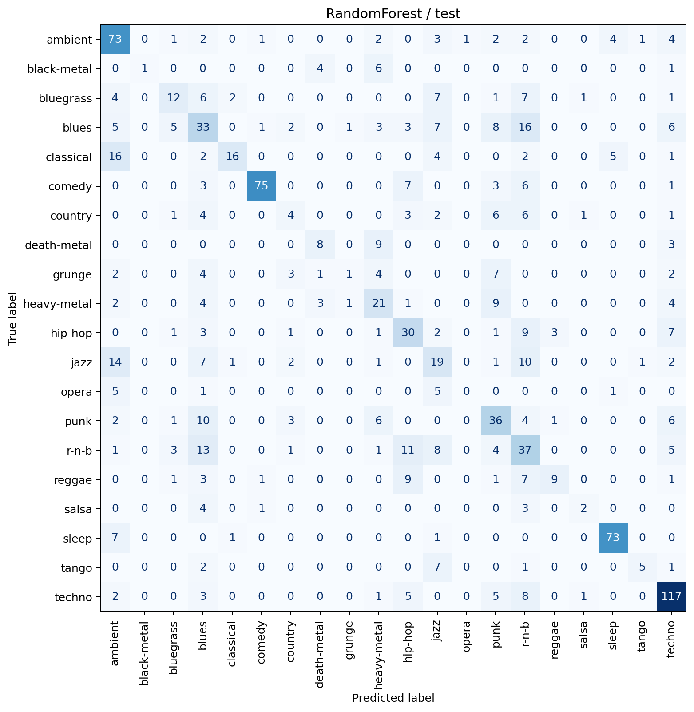
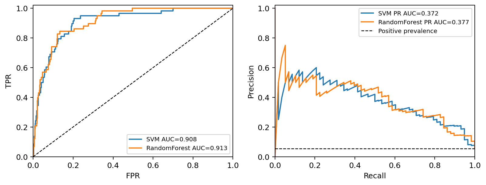

# HW2 Classify a Music Catalog

113062273 許晉豪

沿用 pre-report：指定的 13 個音訊欄位，80% training（4,240 首）、20% 分層 test（1,060 首）。Training 用 5-fold StratifiedKFold（shuffle=True），以平均 macro-F1 選參數；seed=113062273，bootstrap 穩定性實驗用 seed+折編號 0–4。Scaler 只 fit 各折 training，選定後才評估 test。以下 CV 為平均 ± 樣本標準差；表格中的比例指標以 % 表示，AUC 採 0-1。最佳 CV 分數有調參造成的樂觀偏差。

## 3.1 kNN

(a) 第一折 validation 的三首錯誤案例。k=8、標準化、Euclidean distance、uniform vote；表中為依距離排序的 8 個 training 鄰居。row 從 0 起算。

| 順位 | row 1379：opera → ambient | row 3320：reggae → hip-hop | row 470：techno → heavy-metal |
| --- | --- | --- | --- |
| 1 | blues (2.3553) | hip-hop (0.9225) | r-n-b (0.7600) |
| 2 | r-n-b (2.5202) | comedy (0.9383) | punk (0.9622) |
| 3 | classical (2.5924) | comedy (0.9745) | blues (1.1019) |
| 4 | tango (2.6482) | hip-hop (1.0869) | heavy-metal (1.4085) |
| 5 | jazz (2.6899) | blues (1.1382) | grunge (1.5089) |
| 6 | ambient (2.7107) | reggae (1.1435) | bluegrass (1.5918) |
| 7 | jazz (2.7440) | hip-hop (1.1625) | heavy-metal (1.7711) |
| 8 | ambient (2.8227) | blues (1.1626) | r-n-b (1.7981) |

1379：ambient 2、jazz 2，其餘 blues、classical、r-n-b、tango 各 1；同票由類別排序較前的 ambient 勝出。3320：hip-hop 3、blues 2、comedy 2、reggae 1。470：heavy-metal 2、r-n-b 2，其餘 bluegrass、blues、grunge、punk 各 1；同票選 heavy-metal。opera 和 techno 在鄰居中都沒有票，reggae 也只有 1 票，因此猜錯。

(b) 掃 k=1–100。k=1 的 training accuracy=100%，因為自己是距離為 0 的鄰居，且資料沒有相同音訊特徵的歌曲。k 增加使投票更平滑，train score 下降，CV accuracy 先升；太大則小類別更容易輸給大類別。

| k | CV Acc | CV F1 | death-metal R | tango R | opera R | black-metal R | salsa R | 平均 R |
| --- | --- | --- | --- | --- | --- | --- | --- | --- |
| 1 | 38.82 | 30.01 | 23.75 | 21.10 | 6.00 | 10.89 | 48.57 | 22.06 |
| 8 | 44.29 | 34.20 | 18.75 | 23.96 | 4.00 | 15.11 | 36.43 | 19.65 |
| 57 | 46.08 | 30.88 | 2.50 | 23.96 | 0.00 | 0.00 | 0.00 | 5.29 |
| 100 | 44.22 | 26.91 | 1.25 | 6.04 | 0.00 | 0.00 | 0.00 | 1.46 |

Accuracy 最佳 k=57，macro-F1 最佳 k=8，後續選 k=8。k=57 的 rare recall 平均只有 5.29%，低於 k=8 的 19.65%，所以 accuracy 較高不代表各類都較好。

(c) 標準化後加入 N 個 N(0,1) 雜訊欄，一次產生全部歌曲的雜訊，跨折保持相同。固定 k=8，每首保留率=原、新鄰居交集筆數/8。

| N | CV Accuracy | CV Macro-F1 | 平均鄰居保留率 |
| --- | --- | --- | --- |
| 0 | 44.29 ± 0.65 | 34.20 ± 1.91 | 100.00 |
| 5 | 40.05 ± 0.66 | 27.08 ± 1.03 | 26.53 |
| 20 | 35.64 ± 1.84 | 22.71 ± 1.70 | 9.17 |
| 50 | 29.88 ± 1.20 | 18.85 ± 1.27 | 4.25 |

N 欄雜訊平均增加 2N 的平方距離，卻與曲風無關，所以會改變鄰居排序。N=50 時只保留 4.25% 原鄰居，macro-F1 降到 18.85%。每首的保留率另存 knn_noise_per_track.csv。

# 3.2 Naive Bayes

(a) 第一折預設 GaussianNB，var_smoothing=1e-9。Validation row 3320 真實為 reggae，最高兩類 A=reggae、B=hip-hop，概率 0.5791、0.3793。下表是 log[P(A|x)/P(B|x)] 的 14 項，正值支持 A。

| 項目 | 貢獻 | 項目 | 貢獻 |
| --- | --- | --- | --- |
| prior | -0.595383 | valence | 0.511688 |
| danceability | -0.016496 | loudness | -0.060165 |
| energy | -0.066749 | tempo | -0.085194 |
| speechiness | -0.066534 | key | -0.079523 |
| acousticness | 0.277717 | mode | -0.128445 |
| instrumentalness | 0.322396 | time_signature | 0.569608 |
| liveness | -0.230423 | duration_ms | 0.070766 |

合計 0.423261，故選 reggae。先驗支持 hip-hop，但 time_signature、valence、instrumentalness、acousticness 使結果反轉。time_signature 的 x=0.2967 接近兩類平均（0.3140、0.2681），A 的變異數較小（0.0914、0.2856），貢獻 +0.5696。Valence 的 x=1.0949 較近 A 平均 0.8839，而非 B 的 0.3960，變異數為 0.4573、0.6937，貢獻 +0.5117。Instrumentalness 的兩類平均接近，但 A 變異數 0.0097 小於 B 的 0.0187，讓接近平均的 x 得到較高密度。以上為標準化尺度。

(b) 理論上各欄縮放的密度因子會在類別比值中抵消；sklearn 卻將 epsilon=var_smoothing × max_j Var(Xj) 加到所有欄。第一折 raw 的 duration_ms 變異數約 1.963e10，epsilon=19.6348；標準化後 epsilon 約 1e-9，因此結果不同。

| 預設輸入 | CV Accuracy | CV Macro-F1 |
| --- | --- | --- |
| raw | 28.21 ± 1.30 | 13.35 ± 0.90 |
| standardized | 39.20 ± 1.16 | 30.30 ± 1.51 |

| var_smoothing | CV Accuracy | CV Macro-F1 |
| --- | --- | --- |
| 1e-12 | 37.64 ± 1.44 | 28.87 ± 1.93 |
| 1e-09 | 39.20 ± 1.16 | 30.30 ± 1.51 |
| 0.0001 | 43.00 ± 2.40 | 33.46 ± 2.45 |
| 0.1 | 45.47 ± 1.45 | 35.80 ± 1.12 |
| 1 | 43.49 ± 1.24 | 26.59 ± 1.47 |

後續選 0.1，macro-F1=35.80%；0.01 為 35.71%，差距小於折間變動。預設值的問題是 salsa 的 time_signature 在 training 全為 4，類內變異數近 0。第一折 validation 只有 7 首 salsa，預設卻預測 174 首，僅 6 首正確；smoothing=0.1 後預測 25 首、4 首正確。極尖的拍號密度使其他四拍歌曲也容易被誤認。

(c) Comedy 的 instrumentalness 有 87.17% 恰為 0、99.74% 小於 0.01；擬合的 Gaussian 卻有 47.77% 機率落在 0–1 之外，不符 Gaussian 假設。Ambient 類內 energy、loudness 的相關 r=0.8009（n=385），也違反類內獨立假設。

(d) 使用 smoothing=0.1，額外複製 energy。副本沒有新資訊，NB 卻會重複乘入 likelihood，使這個特徵的權重變大。

| 副本數 | CV Accuracy | 平均信心 |
| --- | --- | --- |
| 0 | 45.47 ± 1.45 | 60.19 |
| 1 | 44.86 ± 1.92 | 61.78 |
| 3 | 42.71 ± 1.89 | 64.23 |
| 5 | 40.26 ± 1.54 | 66.40 |

可靠度圖每 0.1 分一格，點在對角線下代表過度自信。副本由 0 到 5，信心升至 66.40%，accuracy 卻降至 40.26%，表示更有信心卻沒有更準。

epsilon 依本機 sklearn 1.7.1 _partial_fit 與 [GaussianNB 官方文件](https://scikit-learn.org/1.7/modules/generated/sklearn.naive_bayes.GaussianNB.html)。

# 3.3 Decision Trees

(a) 第一折 training 的 max_depth=3 決策樹。用原始 13 欄，criterion=gini、splitter=best、min_samples_leaf=1。Gini=1-sum_i(p_i^2)，每次選使子節點加權 Gini 下降最多的分裂。

| 層 | 特徵 | 門檻 | 加權 Gini 下降 | 左／右最多類別 |
| --- | --- | --- | --- | --- |
| 0 | speechiness | 0.6095 | 0.065493 | techno / comedy |
| 1 | loudness | -15.7375 | 0.043125 | sleep / techno |
| 2 | danceability | 0.2440 | 0.012844 | sleep / ambient |
| 2 | instrumentalness | 0.2905 | 0.044638 | r-n-b / techno |
| 1 | acousticness | 0.2980 | 0.000587 | r-n-b / comedy |

根節點以 speechiness 分出 234 首，其中 233 首 comedy，下降最大。左側再以 loudness 分出 sleep 較多的安靜歌曲；右側 acousticness 只再分出 1 首 r-n-b，所以整體下降很小。各門檻左側為 <=，右側為 >。

深度 3 的 CV accuracy=33.09 ± 1.62、macro-F1=13.83 ± 0.70。第一折從未預測：black-metal、bluegrass、blues、classical、country、death-metal、grunge、heavy-metal、hip-hop、jazz、opera、punk、reggae、salsa、tango。每個葉節點只選最多的類別，這些類別在葉內都不是多數。

(b) 分別掃 max_depth 與 min_samples_leaf，另一項維持預設。圖中的 depth=100 表示 None（不限制深度）。

平均葉數（設定:葉數）：max_depth 為 1:2、2:4、3:7、5:19.6、8:106.4、12:502.8、20:1165.6、None:1194.8；min_samples_leaf 為 1:1194.8、2:854、5:426.8、10:223.2、30:78、100:25.4、500:6。

depth=1–3 時 train、CV 都低，是欠擬合。不限深度時 train macro-F1=100%，CV 只有 31.21%，是過擬合；depth=12 的 CV=34.21% 最好，因此單樹選 12。min_leaf=1 也過擬合，增加到 10 時 CV=33.57%；加到 500 又降為 13.41%，限制太多同樣學不好。

# 3.3 Ensembles

(c) 比較完整單樹、bagging、RF。Bagging 每棵 bootstrap 抽 n 筆、可用全部 13 欄；RF 每個 split 只抽 3 個候選特徵。皆用 Gini、min_leaf=1、固定 random_state，不加 class weight。

每折用相同兩組 bootstrap training 樣本分別訓練，再比較 validation 預測。不同率為單樹 62.31±2.81%、bagging 31.77±2.07%、RF 24.29±1.05%，ensemble 都用 300 棵。增加樹數後 CV 分數上升，100 到 300 的提升已較小。

若每棵輸出變異數為 s^2、相關為 r，B 棵平均的變異數=s^2[r+(1-r)/B]。多棵平均降低不共同的變動；RF 隨機限制特徵有助降低相關。本次 RF 的分數較高、預測也較穩定，但沒有直接估計樹間相關，不能斷言這是唯一原因。

# 3.4 Support Vector Machines

(a) 每折標準化。C={0.1,1,10,100,1000}、gamma={0.001,0.01,0.1,1,10}，各跨四個數量級。RBF、tol=0.001、max_iter=-1、class_weight=None；調參不開 probability。

K(x,z)=exp(-gamma||x-z||^2)。Gamma 小使影響範圍廣、邊界較平滑，大則很局部；C 越大，越重視配合 training。C=0.1、gamma=0.001 時 train/CV macro-F1=7.09/7.06%，是欠擬合；C=1000、gamma=10 時為 100/1.53%，是過擬合。選 C=10、gamma=0.1，CV macro-F1=39.70±2.95%。

# 3.4 Support Vectors

(b) 固定 gamma=0.01，在全部 training 擬合。下表列三個 C；每格為「支持向量比例 / CV F1」，單位 %。CV F1 由相同設定的五折平均計算。

| 曲風 | Training n | C=0.1：SV / F1 | C=10：SV / F1 | C=1000：SV / F1 |
| --- | --- | --- | --- | --- |
| ambient | 385 | 99.48 / 50.13 | 75.32 / 57.82 | 75.84 / 58.31 |
| black-metal | 46 | 100.00 / 0.00 | 100.00 / 6.97 | 97.83 / 18.96 |
| bluegrass | 164 | 100.00 / 0.00 | 98.78 / 30.38 | 92.07 / 36.97 |
| blues | 359 | 100.00 / 25.12 | 97.77 / 31.80 | 95.26 / 30.87 |
| classical | 185 | 100.00 / 0.00 | 94.59 / 39.60 | 88.11 / 42.22 |
| comedy | 382 | 58.12 / 87.60 | 27.23 / 87.09 | 28.27 / 83.11 |
| country | 113 | 100.00 / 0.00 | 100.00 / 0.00 | 100.00 / 14.77 |
| death-metal | 80 | 100.00 / 0.00 | 100.00 / 29.08 | 88.75 / 36.10 |
| grunge | 94 | 100.00 / 0.00 | 100.00 / 0.00 | 100.00 / 12.98 |
| heavy-metal | 178 | 100.00 / 0.00 | 96.63 / 40.68 | 95.51 / 39.76 |
| hip-hop | 231 | 100.00 / 0.00 | 93.07 / 41.44 | 90.48 / 44.26 |
| jazz | 231 | 100.00 / 0.00 | 99.57 / 28.52 | 98.27 / 20.76 |
| opera | 50 | 100.00 / 0.00 | 100.00 / 3.64 | 100.00 / 0.00 |
| punk | 275 | 100.00 / 12.69 | 91.64 / 44.04 | 87.64 / 42.43 |
| r-n-b | 338 | 100.00 / 0.00 | 97.34 / 29.55 | 94.67 / 31.48 |
| reggae | 128 | 100.00 / 0.00 | 100.00 / 25.51 | 90.62 / 32.12 |
| salsa | 39 | 100.00 / 0.00 | 100.00 / 35.94 | 87.18 / 47.08 |
| sleep | 329 | 94.83 / 72.96 | 54.41 / 77.71 | 51.67 / 76.54 |
| tango | 66 | 100.00 / 0.00 | 98.48 / 34.51 | 93.94 / 42.28 |
| techno | 567 | 71.25 / 66.02 | 39.33 / 78.80 | 36.33 / 78.89 |

C=10 時 comedy 的 SV 比例 27.23%、F1=87.09%；salsa 為 100%、35.94%。小類別也常有高 SV 比例，但這不能直接當重疊程度：C 小使較多點落在 margin 內，多類別 one-versus-one 的任一邊界也可能讓它成為 SV。固定資料只改 C，比例與 F1 就會改變，因此要連同筆數、C 和 validation F1 判斷。

# 4.1 Beyond Accuracy

| 模型 | CV Accuracy | CV Macro-F1 | Acc-F1 差距 |
| --- | --- | --- | --- |
| 完整單樹 | 41.27 ± 0.92 | 31.21 ± 0.59 | 10.06 |
| kNN | 44.29 ± 0.65 | 34.20 ± 1.91 | 10.10 |
| GaussianNB | 45.47 ± 1.45 | 35.80 ± 1.12 | 9.67 |
| 單樹 depth=12 | 43.54 ± 1.01 | 34.21 ± 1.29 | 9.33 |
| Bagging 300 | 52.74 ± 1.31 | 42.31 ± 2.07 | 10.43 |
| RF 300 | 54.65 ± 0.84 | 43.22 ± 2.04 | 11.43 |
| SVM | 49.67 ± 1.60 | 39.70 ± 2.95 | 9.97 |

4.1(a)(b) 每家族以 CV macro-F1 選設定，整體選 RF。Accuracy 對每首同權重，macro-F1 對每類同權重；小類別表現較差，因此兩者差距約 9–11 個百分點。以下 test 矩陣列為真實、欄為預測；accuracy=53.96%、macro-F1=41.67%。

# 4.1 Test Results

## 各曲風的 AUC 與 F1

4.1(c) AUC 使用 RF 的每類 predicted probability 做 one-versus-rest。

| 曲風 | n | F1 | OvR AUC |
| --- | --- | --- | --- |
| ambient | 96 | 63.76 | 0.9368 |
| black-metal | 12 | 15.38 | 0.9870 |
| bluegrass | 41 | 36.36 | 0.9325 |
| blues | 90 | 34.02 | 0.8329 |
| classical | 46 | 48.48 | 0.9435 |
| comedy | 95 | 86.21 | 0.9842 |
| country | 28 | 18.18 | 0.8505 |
| death-metal | 20 | 44.44 | 0.9853 |
| grunge | 24 | 7.41 | 0.9058 |
| heavy-metal | 45 | 42.00 | 0.9478 |
| hip-hop | 58 | 47.24 | 0.9325 |
| jazz | 58 | 30.89 | 0.8345 |
| opera | 12 | 0.00 | 0.9767 |
| punk | 69 | 47.06 | 0.9084 |
| r-n-b | 84 | 36.63 | 0.8521 |
| reggae | 32 | 40.00 | 0.9229 |
| salsa | 10 | 26.67 | 0.9499 |
| sleep | 82 | 88.48 | 0.9956 |
| tango | 16 | 43.48 | 0.9574 |
| techno | 142 | 76.72 | 0.9659 |

稀有五類的 precision、recall：

| 曲風 | Precision | Recall |
| --- | --- | --- |
| death-metal | 50.00 | 40.00 |
| tango | 71.43 | 31.25 |
| opera | 0.00 | 0.00 |
| black-metal | 100.00 | 8.33 |
| salsa | 40.00 | 20.00 |
| 平均 | 52.29 | 19.92 |

F1 最低的 opera、grunge、black-metal，分別有 5 首被分成 ambient、7 首分成 punk、6 首分成 heavy-metal。Opera AUC=0.9767 但 F1=0，因為 AUC 只看同一類對正負例的排序，最後仍可能被其他類的分數超過。每類 test 筆數少，這些結果也會受抽樣影響。

# 4.2 hiphop detector

(a) 重新以 hip-hop/其他訓練 SVM、RF，用 CV average precision（AP）選參數，因為正例少且關心挑出的歌曲。SVM 掃 C={0.1,1,10}、gamma={0.001,0.01,0.1}，選 10、0.1（CV AP=32.30±3.17%）；RF 固定 300 棵，掃 depth={5,12,None}，選 12（44.20±8.97%）。

(b) Test 有 58 首 hip-hop、1002 首其他歌曲。永遠回答不是 hip-hop 的 accuracy=94.53%，recall=0。以下矩陣為 [[TN,FP],[FN,TP]]；SVM 門檻 0、RF 門檻 0.5。

| 模型 | [[TN,FP],[FN,TP]] | Acc | TPR | TNR | PPV | NPV | F1 |
| --- | --- | --- | --- | --- | --- | --- | --- |
| SVM | [[990,12],[44,14]] | 94.72 | 24.14 | 98.80 | 53.85 | 95.74 | 33.33 |
| RandomForest | [[994,8],[51,7]] | 94.43 | 12.07 | 99.20 | 46.67 | 95.12 | 19.18 |

(c) SVM 的 ROC/PR AUC=0.9079/0.3720，RF=0.9127/0.3768；PR AUC 採梯形積分。兩者的排序有用，但預設 recall 只有 24.14%、12.07%，高 accuracy 主要來自負例多。PR 圖的水平線是正例比例，可搭配曲線判斷人工挑選的成本。

(d) 選 CV AP 較高的 RF，用 training OOF scores 找 recall>=80% 的最高門檻，得到 t=0.07541858，OOF recall=80.09%。Test 不再調整：TP=49、FN=9、FP=163、TN=839，recall=84.48%，有達到八成。需聽 212/1060 首；每千首約聽 200 首、漏掉 8.5 首 hip-hop。預設只需聽 15 首卻漏掉 51 首，降低門檻用更多人工量換取較高 recall；OOF 達標不保證其他批資料也達標。
