# HW3 Neural Networks on Oracle Bone Characters

113062273 許晉豪

## Protocol

5,200 張依類別分層切成 training 4,160、test 1,040；training 再分層切出 20% 當 validation（fit 3,328、validation 832）。切分、初始化、洗牌的 seed 都是 113062273，每個網路只訓練一次。fit 用來訓練，validation 用來比較和選參數，test 只在 6.1b 用一次。標準化的 μ、σ 只用 fit 算（6.1b 改用整個 training）。Section 3–5 報最後一個 epoch，同一題的 epoch 數都一樣。

| 題目 | Hidden layers × units | Activation | Loss | Optimizer | lr | Batch | Epochs |
| --- | --- | --- | --- | --- | --- | --- | --- |
| 3.1a | 2 × 192 | ReLU / sigmoid | CE | Adam | 1e-3 | 64 | 50 |
| 3.2 | 2 × 192 | ReLU | CE / squared error | SGD | 0.05 | 64 | 50 |
| 4.1 | 2 × 192 / 8 × 145 | ReLU | CE | Adam | 1e-3 | 64 | 50 |
| 4.2 | 10 × 128（±BN） | sigmoid | CE | SGD | 0.1 | 64 | 50 |
| 5.1 | 2 × 192 | ReLU | CE | SGD | 0.05 | 8 / 512 | 50 |
| 5.2 | 2 × 192 | ReLU | CE | SGD / SGD+momentum 0.9 | 0.01 | 64 | 50 |
| 5.3 | 2 × 192 | ReLU | CE | Adam | 1e-3 | 64 | 50 |
| 6.1 | 2 × 192 | ReLU | CE + L2 | Adam | 1e-3 | 64 | ≤200（選 164） |

2 × 192 是 shallow、8 × 145 是 deep，就是 pre-report 的兩個主網路（490,762 和 490,835 個參數）。題目說「the same network」的地方（3.2、5.1、5.2、5.3）都用 shallow。

用到的預設值：

- **初始化：** W、b 用 PyTorch 預設的 U(±1/√fan_in)。標準化輸入時第一層輸出的標準差是 0.60，sigmoid 不會飽和，所以不另外設。
- **Adam：** β=(0.9, 0.999)、eps=1e-8，tutorial 的建議值。
- **CE：** 對 batch 取平均，lr 不用跟著 batch size 改。
- **SGD：** 沒有 dampening、沒有 Nesterov，就是投影片的 w ← w − ηg。
- **BatchNorm1d：** γ=1、β=0，一開始就是純標準化；eps=1e-5 避免除以 0。

## 3.1 ReLU or sigmoid?

(a) 兩個網路都是 2352 → 192 → 192 → 10，activation 沒有參數，都是 490,762 個參數。

| 網路 | Acc | Macro-P | Macro-R | Macro-F1 | arrow | time | wood | 稀有平均 |
| --- | --- | --- | --- | --- | --- | --- | --- | --- |
| (i) ReLU | 0.659 | 0.558 | 0.524 | 0.533 | 0.459 (17/37) | 0.227 (5/22) | 0.077 (1/13) | 0.255 |
| (ii) sigmoid | 0.653 | 0.520 | 0.502 | 0.506 | 0.351 (13/37) | 0.182 (4/22) | 0.000 (0/13) | 0.178 |

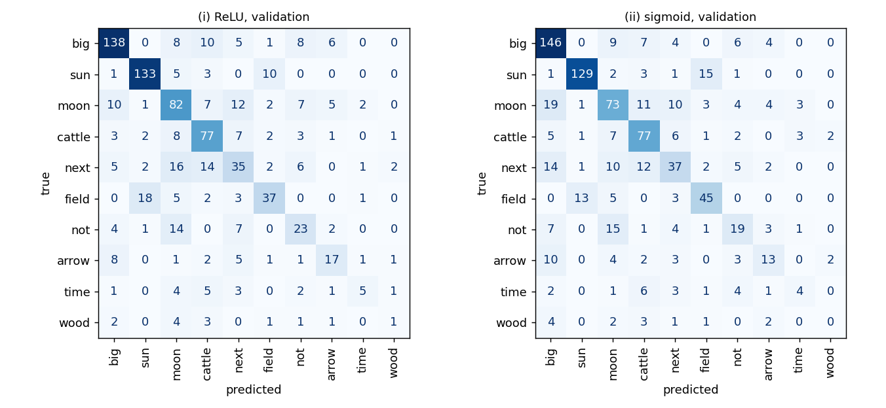

我在 pre-report 預測 ReLU 練得比較快、分類最好，sigmoid 比較慢。方向對：第 1 個 epoch 的 validation macro-F1 是 0.29 對 0.16，第 10 個是 0.48 對 0.43。但最後只差 0.027，比預期小：

- 只有 2 層，σ′≤0.25 只乘兩次，梯度還傳得回去。
- Adam 依每個參數的梯度大小調步伐，抵掉一部分 σ′ 的縮小。

差最多的是稀有字。confusion matrix 裡 sigmoid 預測成 big 的有 208 張，ReLU 是 172 張，wood 一張都沒抓到。

(b) Step 的導數除了 z=0 以外都是 0。Backprop 是 δ = f′(a) Σ w δ_next、Δw = α δ x，乘到 f′=0 梯度就沒了，hidden layer 的權重永遠不會動。Sigmoid 是平滑的 step，導數 σ(1−σ) 處處大於 0，權重改一點、輸出就跟著改一點，梯度才傳得回去。

(c) 用 ReLU (i) 的 confusion matrix 手算（列是真實、欄是預測）：

- **big（常見）：** TP=138；欄總和 172 → FP=34；列總和 176 → FN=38。
  - P=138/172=0.802
  - R=138/176=0.784
  - F1=2×0.802×0.784/(0.802+0.784)=0.793
- **wood（稀有）：** TP=1；欄總和 6 → FP=5；列總和 13 → FN=12。
  - P=1/6=0.167
  - R=1/13=0.077
  - F1=2×0.167×0.077/(0.167+0.077)=0.105

Accuracy 每張圖一樣重，big、sun、moon 就佔 validation 的 55%（456/832），所以 accuracy（0.659）主要看大類別。Macro-F1 每一類一樣重，wood 的 F1 只有 0.105，就把 macro-F1 拉到 0.533。Weighted 平均用張數加權，又回到接近 accuracy（weighted F1 0.653）。所以長尾資料可以 accuracy 不錯、稀有字卻幾乎抓不到。

博物館要找稀有字，就看三個稀有字各自的 recall：真的稀有字有幾張被找到。再搭配 precision：wood 被預測 6 次錯 5 次，precision 太低專家會被誤報淹沒。

## 3.2 Choosing the loss

(a) shallow、ReLU，CE 和 squared error（softmax 輸出對 one-hot）各練 50 個 epoch。用 plain SGD，因為 SGD 一步就是 lr × 梯度，看得出兩個 loss 的梯度大小；Adam 會把梯度除以它自己的大小，蓋掉這個差別。

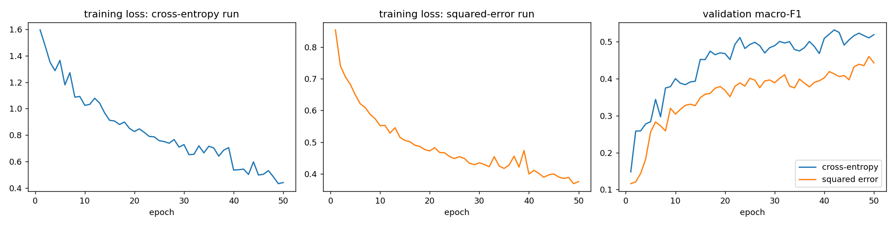

| Loss | Acc | Macro-P | Macro-R | Macro-F1 | arrow | time | wood | 稀有平均 |
| --- | --- | --- | --- | --- | --- | --- | --- | --- |
| CE | 0.653 | 0.576 | 0.517 | 0.520 | 0.297 (11/37) | 0.136 (3/22) | 0.154 (2/13) | 0.196 |
| Squared error | 0.623 | 0.491 | 0.445 | 0.443 | 0.162 (6/37) | 0.000 (0/22) | 0.000 (0/13) | 0.054 |

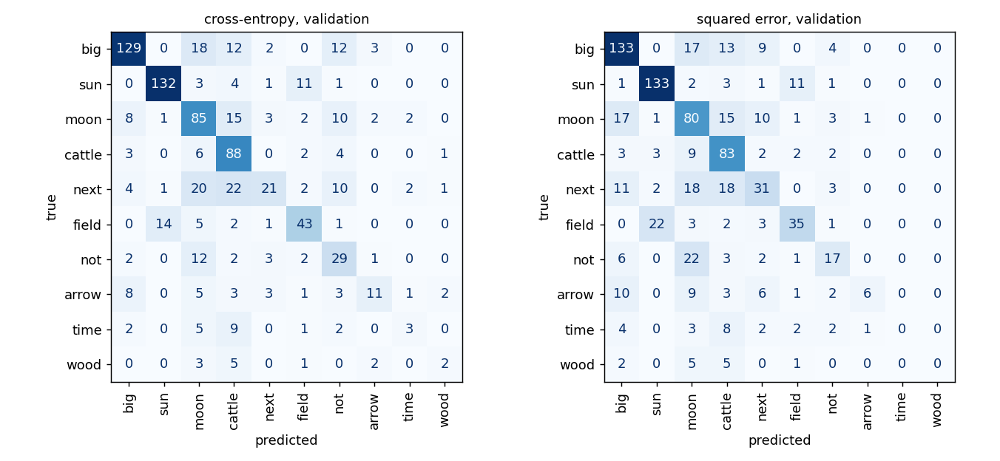

CE 從頭到尾學得比較快：第 10 個 epoch 的 validation macro-F1 是 0.40 對 0.30，第 50 個的 train macro-F1 是 0.77 對 0.53。squared error 的 confusion matrix 裡 time、wood 兩欄全是 0，到最後都沒學會預測這兩類。

設 p 是 softmax 輸出、t 是 one-hot、z 是 output unit 的輸入：

- **CE：** ∂L/∂z_k = p_k − t_k。
- **Squared error：** ∂L/∂z_k = 2p_k [ (p_k − t_k) − Σ_j (p_j − t_j) p_j ]。

Squared error 多乘了一個 p_k。很有信心地答錯時，正確類別的 p_k 接近 0，梯度也接近 0，錯越多推越小；CE 這時 p_k − 1 接近 −1，推力最大。p_true=0.01（錯的類別 0.98）時，CE 的梯度是 −0.99，squared error 只有 −0.039，小 25 倍。所以訓練完 squared error 還有 236 張 fit 圖的 p_true<0.05，CE 只剩 56 張。

## 4.1 Shallow or deep?

(a) 兩個主網路，其他全部一樣。

| 網路 | 第 1 層 | 中間層 | 輸出層 | 合計 |
| --- | --- | --- | --- | --- |
| Shallow | 2352→192：451,776 | 192→192：37,056 | 192→10：1,930 | 490,762 |
| Deep | 2352→145：341,185 | 145→145：21,170 × 7 | 145→10：1,460 | 490,835 |

| 網路 | Train macro-F1 | Val acc | Macro-P | Macro-R | Val macro-F1 | arrow | time | wood | 稀有平均 | 訓練時間 |
| --- | --- | --- | --- | --- | --- | --- | --- | --- | --- | --- |
| Shallow | 0.997 | 0.659 | 0.558 | 0.524 | 0.533 | 0.459 (17/37) | 0.227 (5/22) | 0.077 (1/13) | 0.255 | 14.9 s |
| Deep | 0.770 | 0.609 | 0.498 | 0.468 | 0.472 | 0.162 (6/37) | 0.136 (3/22) | 0.231 (3/13) | 0.176 | 25.5 s |

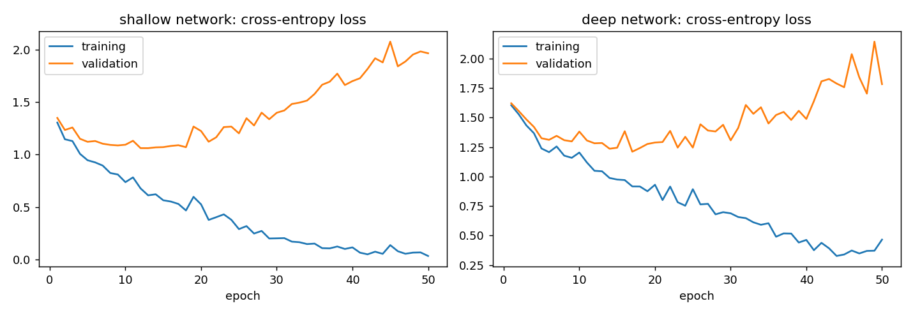

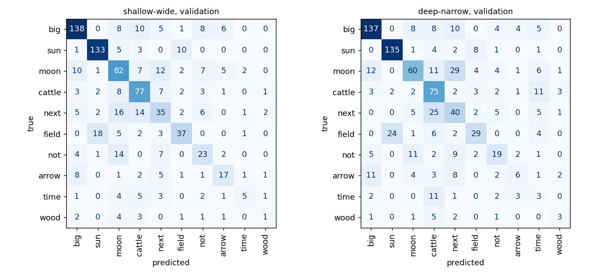

(b) **哪個比較好：** shallow。validation macro-F1 高 0.061、稀有平均高 0.08、訓練也比較快。Deep 只多抓到 2 張 wood，錯得更分散：moon → next 29 張、field → sun 24 張。Loss 曲線上，shallow 是過擬合（train loss 掉到 0.03，validation loss 在第 12–18 個 epoch 最低，之後一路上升）；deep 是 50 個 epoch 還沒學完（train macro-F1 只有 0.77）。

**只跑一次能多確定：** 對 832 張 validation 做 2,000 次 paired bootstrap，差距的 95% 區間是 [0.012, 0.111]，不含 0；最後 10 個 epoch 的平均是 0.533 對 0.473，曲線也沒交叉。所以差距不是剛好抽到哪些 validation 圖造成的，但換 seed 會不會翻盤，跑一次看不出來。

**階層式表示：** 這份資料不支持。同樣參數量下，8 層沒有比 2 層好，原因：

- **MLP 把圖攤平：** 每個像素各有一個權重，網路不知道哪些像素相鄰，筆畫偏 2 px 就是完全不同的輸入。
- **流形：** 同一個字的變化主要是平移、粗細、彎曲，這些圖落在一個低維流形上。要學出「筆畫 → 部件 → 字」，前面的層得在不同位置重複用同一個局部特徵，fully connected 做不到。
- **參數和資料：** deep 碰到像素的第一層反而比較小（341,185 對 451,776），3,328 張圖也不夠深網路學出中間特徵。

**博物館選哪個：** shallow，分數、稀有字、速度都比較好。

## 4.2 Vanishing gradients

(a) 10 個 hidden layer、每層 128 個 sigmoid unit。有 BN 的版本每層是 Linear → BatchNorm1d → Sigmoid（BN 在 activation 前）。都用 plain SGD lr=0.1、batch 64、50 epochs。梯度在初始化和 1 epoch 後都用同一批圖（fit set 前 256 張）算。

| Linear 層 | 無 BN 初始化 | 無 BN 1 epoch | 有 BN 初始化 | 有 BN 1 epoch |
| --- | --- | --- | --- | --- |
| 1 | 1.1e-8 | 6.6e-9 | 1.28 | 0.97 |
| 2 | 2.8e-8 | 9.2e-9 | 0.33 | 0.34 |
| 3 | 2.0e-7 | 7.0e-8 | 0.31 | 0.32 |
| 4 | 1.5e-6 | 5.2e-7 | 0.29 | 0.33 |
| 5 | 1.1e-5 | 3.6e-6 | 0.32 | 0.33 |
| 6 | 7.1e-5 | 2.5e-5 | 0.32 | 0.30 |
| 7 | 5.0e-4 | 1.8e-4 | 0.33 | 0.29 |
| 8 | 0.004 | 0.001 | 0.33 | 0.27 |
| 9 | 0.029 | 0.010 | 0.29 | 0.24 |
| 10 | 0.21 | 0.07 | 0.30 | 0.22 |
| 11（輸出） | 1.44 | 0.45 | 1.43 | 0.48 |

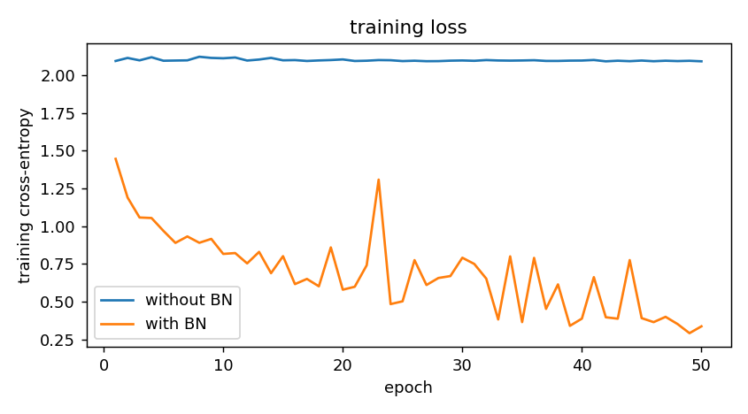

**沒有 BN：** 梯度每往前一層小約 7 倍，第一層只剩 1e-8，前面的層完全不動，1 epoch 後也一樣。Training loss 卡在 2.09，剛好是照類別比例亂猜的 entropy（2.089）。

**有 BN：** 各層梯度都在 0.2–0.3，training loss 從 1.45 降到 0.34。

用 chain rule 解釋：δ_k = σ′(a_k) Σ_j w_kj δ_j，每往前一層多乘一次 σ′（≤0.25）和一次權重。權重從 U(±1/√128) 抽，乘一次權重大約讓梯度變 √(128 × 1/(3·128)) ≈ 0.58 倍，所以每層縮小約 0.25 × 0.58 ≈ 0.14 倍，跟量到的一致，連乘 10 次就沒了。BN 每層把加權和重新標準化成平均 0、標準差 1，sigmoid 停在導數最大的區域；反向時 BN 會除以 batch 的標準差，前面縮小多少就補回多少。

(b) LARS 的 ‖w‖/‖∇w‖：

| Linear 層 | 1 | 2 | 3 | 4 | 5 | 6 | 7 | 8 | 9 | 10 | 11 |
| --- | --- | --- | --- | --- | --- | --- | --- | --- | --- | --- | --- |
| 無 BN 初始化 | 5.6e8 | 2.3e8 | 3.1e7 | 4.3e6 | 6.4e5 | 9.0e4 | 1.3e4 | 1616 | 225 | 32 | 1.3 |
| 無 BN 1 epoch | 9.9e8 | 6.8e8 | 9.5e7 | 1.3e7 | 1.8e6 | 2.6e5 | 3.5e4 | 4669 | 677 | 96 | 4.2 |
| 有 BN 初始化 | 5.1 | 20 | 21 | 22 | 20 | 20 | 20 | 20 | 22 | 22 | 1.3 |
| 有 BN 1 epoch | 6.8 | 19 | 20 | 20 | 20 | 22 | 23 | 24 | 27 | 30 | 5.4 |

LARS 讓每層的 lr 乘上這個比值，每層每步都只移動自己權重大小的同一個比例。

- **沒有 BN：** 第一層會拿到比輸出層大約 4 億倍的 lr，「前面的層不動」會被解掉，所以 LARS 會減輕這個問題。但它不改 forward，前面的層傳出來的東西還是差不多；BN 同時處理 forward 和梯度大小，效果更直接。
- **有 BN：** 第 2–10 層都在 20 左右，LARS 只會調第一層和輸出層。

跟 5.1 的關係：batch 512 每個 epoch 只更新 7 次，同樣 lr=0.05 練 50 個 epoch，training loss 還有 1.39。大 batch 要追上就得把 lr 調大，但共用的大 lr 對比值小的層（像輸出層的 1.3）一步太大會發散，對比值大的層又還是太小。LARS 讓每層各自調整，大 batch 才能安全地用大 lr。

## 5.1 Large-batch and small-batch training

(a) shallow、plain SGD lr=0.05、無 momentum、50 epochs，batch 8 和 512。Training loss 是每個 epoch 結束後在整個 fit set 上算的。

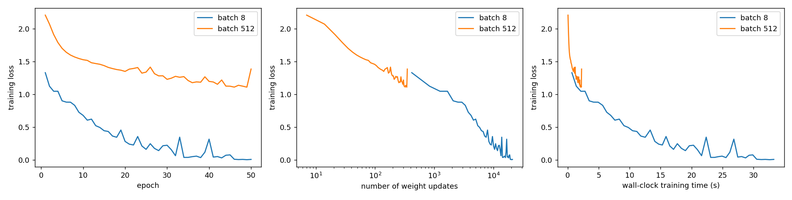

| Batch | 每 epoch 更新 | 總更新 | 總時間 | 每次更新 | 最後 train loss |
| --- | --- | --- | --- | --- | --- |
| 8 | 416 | 20,800 | 33.3 s | 1.6 ms | 0.008 |
| 512 | 7 | 350 | 2.2 s | 6.4 ms | 1.386 |

- **以 epoch 看：** batch 8 每個 epoch 更新 59 倍次數。SGD 每步的長度由 lr 決定，更新越多走越遠，所以 batch 512 練 50 個 epoch 還不如 batch 8 的第 1 個 epoch（1.39 對 1.33）。
- **以更新次數看：** 兩條線差不多接得上。一次用 64 倍的圖算梯度，每步沒有走比較遠，只是方向比較準。
- **以時間看：** batch 512 每次更新只貴 4 倍卻處理 64 倍的圖，總時間短很多；但同樣 2.2 秒時，batch 8 的 loss 已經到 1.05 左右，還是比較低。
- **雜訊：** 在初始化時拿 100 個 batch 的梯度跟整個 fit set 的梯度比，相對誤差是 1.93（batch 8）對 0.22（batch 512），差 8.7 倍 ≈ √64，符合變異數 ∝ 1/batch size。所以 batch 8 的曲線一直有尖刺。

(b)

| Batch | Train macro-F1 | Val acc | Macro-P | Macro-R | Val macro-F1 | arrow | time | wood | 稀有平均 |
| --- | --- | --- | --- | --- | --- | --- | --- | --- | --- |
| 8 | 0.998 | 0.713 | 0.614 | 0.580 | 0.585 | 0.459 (17/37) | 0.182 (4/22) | 0.154 (2/13) | 0.265 |
| 512 | 0.331 | 0.510 | 0.441 | 0.352 | 0.325 | 0.000 (0/37) | 0.000 (0/22) | 0.000 (0/13) | 0.000 |

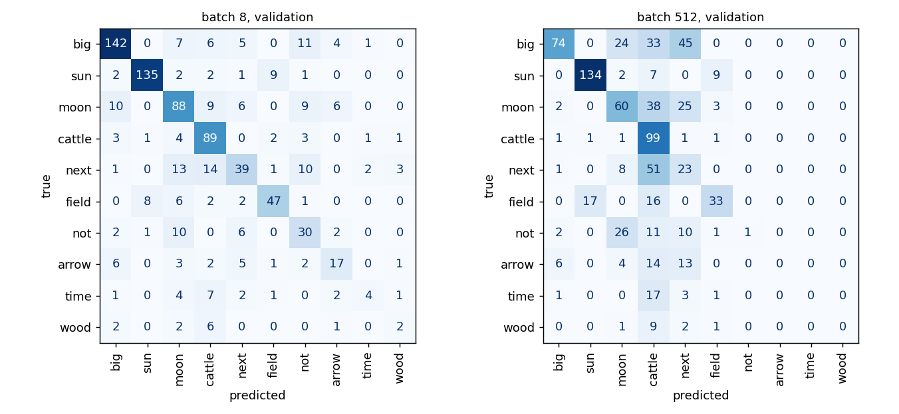

Batch 8 是過擬合（train 0.998、validation 0.585）。Batch 512 的 train 和 validation 都很低，是還沒學完；confusion matrix 裡它從沒預測過 arrow、time、wood，大量圖被丟到 cattle 和 next。

常見的解釋是小 batch 的雜訊讓參數不容易停在很尖的最小值，落在比較平的地方，對新資料比較不敏感。但這組實驗撐不起這個說法：batch 512 連 training 都沒學起來，validation 低是因為沒學完，不是泛化差。要比泛化，得先讓兩邊練到一樣低的 training loss 再比。

## 5.2 Optimizers

(a) shallow、batch 64、50 epochs，lr 固定 0.01，比 plain SGD 和 SGD + momentum（β=0.9）。

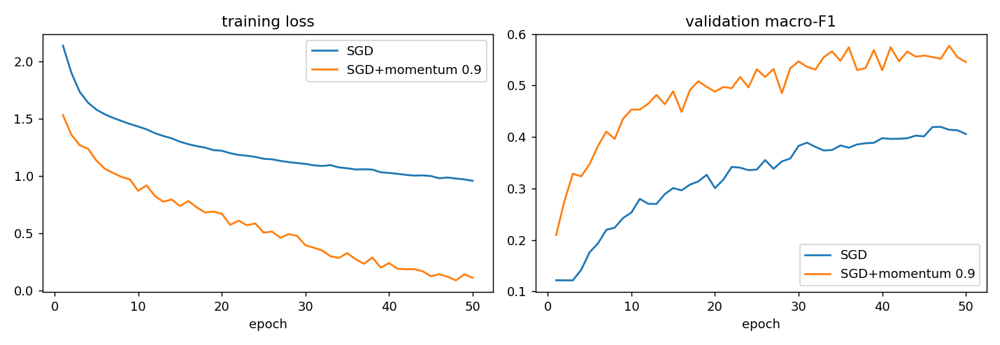

| Optimizer | Train macro-F1 | Val acc | Macro-P | Macro-R | Val macro-F1 | arrow | time | wood | 稀有平均 |
| --- | --- | --- | --- | --- | --- | --- | --- | --- | --- |
| SGD | 0.462 | 0.609 | 0.478 | 0.418 | 0.406 | 0.027 (1/37) | 0.000 (0/22) | 0.000 (0/13) | 0.009 |
| Momentum | 0.952 | 0.666 | 0.544 | 0.558 | 0.546 | 0.432 (16/37) | 0.455 (10/22) | 0.000 (0/13) | 0.296 |

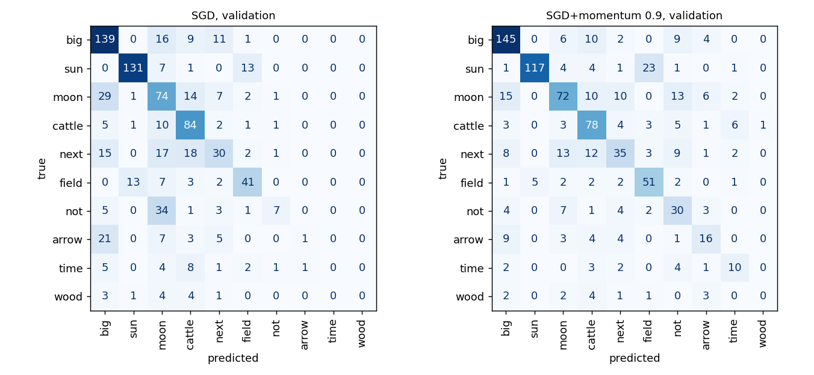

為什麼選 0.01：momentum 穩定時的實際步伐是 lr/(1−β) = 10 × lr。3.2、5.1 的 plain SGD 用 0.05 很穩，lr=0.01 時 momentum 的實際步伐是 0.1，只大一倍；用 0.05 的話會變 0.5，比的就變成會不會發散。所以 0.01 對兩個都安全。

(b) 更新規則：

- **SGD：** w ← w − η·g。
- **Momentum：** v ← β·v − η·g，w ← w + v，也就是投影片的 Δw(n) = η δ x + α Δw(n−1)。

梯度方向一致時，v 會累積到大約 η·g/(1−β)，步伐放大 10 倍；方向來回跳時（狹長山谷裡左右彈），v 裡的正負互相抵消，比較不震盪。所以同一個 lr 下 momentum 比較好。

實驗相符：momentum 第 8 個 epoch training loss 就 < 1，SGD 要到第 46 個；validation macro-F1 是 0.546 對 0.406。SGD 的 confusion matrix 從沒預測過 time、wood，not 有 34 張被判成 moon、arrow 有 21 張被判成 big，還停在只會分大類的階段。

## 5.3 With or without preprocessing

(a) shallow、Adam 1e-3、batch 64、50 epochs。

- **沒有前處理：** 直接用 0–255。
- **我的前處理：** (1) 除以 255。(2) 每個像素各自標準化 (x_j − μ_j)/σ_j，μ_j、σ_j 只用 fit set 算。

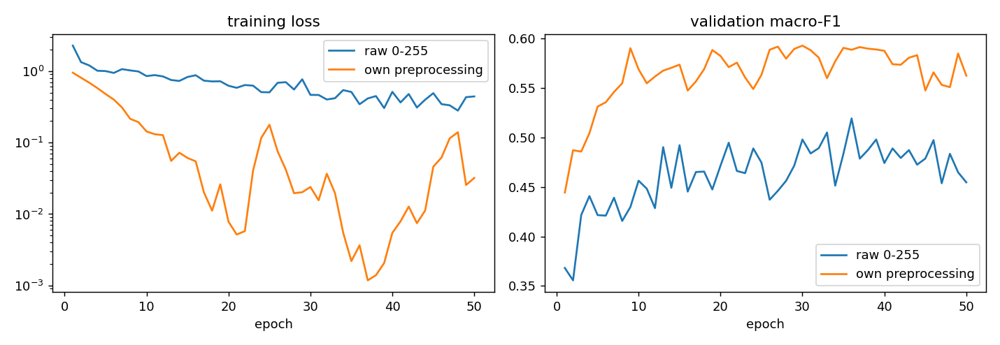

| 輸入 | Acc | Macro-P | Macro-R | Macro-F1 | arrow | time | wood | 稀有平均 |
| --- | --- | --- | --- | --- | --- | --- | --- | --- |
| Raw 0–255 | 0.607 | 0.482 | 0.456 | 0.455 | 0.297 (11/37) | 0.000 (0/22) | 0.077 (1/13) | 0.125 |
| 我的前處理 | 0.679 | 0.581 | 0.551 | 0.563 | 0.378 (14/37) | 0.318 (7/22) | 0.231 (3/13) | 0.309 |

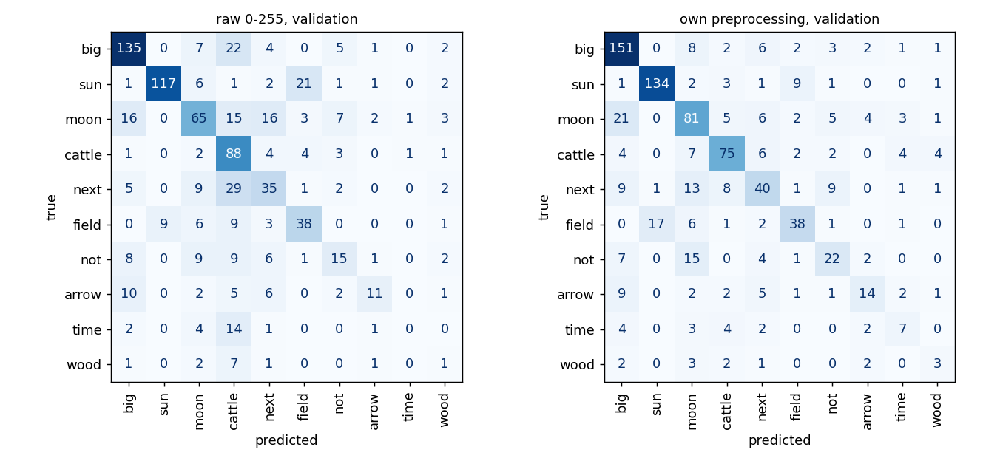

前處理後 macro-F1 高 0.108，稀有平均從 0.125 變 0.309。Raw 的網路特別愛猜 cattle：time 有 14/22 張、next 有 29/83 張被判成 cattle。Raw 的 training loss 一直在 0.3–1.0 之間跳。

(b) 同一組初始權重、同樣 256 張 fit 圖，第一層在初始化時：

| 輸入 | 輸入平均 | 第一層加權和的標準差 | 若是 sigmoid：飽和比例（\|z\|>5） | 平均 σ′ | 第一層梯度 norm | 初始 loss |
| --- | --- | --- | --- | --- | --- | --- |
| Raw | 60.8 | 53.9 | 91.6% | 0.0085 | 302.6 | 12.8 |
| 我的前處理 | 0.0 | 0.60 | 0% | 0.233 | 1.06 | 2.3 |

- **加權和（尺度）：** z = Wx + b。輸入大 255 倍，加權和的標準差從 0.60 變 53.9，輸出極端，初始 loss 12.8（均勻亂猜是 2.3）。
- **加權和（平均）：** raw 全是正數、平均 60.8，每個 unit 的加權和都多一個「權重總和 × 60.8」的偏移，跟圖片內容無關。標準化後平均是 0，沒有這個偏移。
- **Sigmoid 飽和：** 這題是 ReLU；換成 sigmoid 的話 91.6% 的 unit 一開始就卡在 0 或 1，平均導數從 0.233 掉到 0.0085（小 27 倍），梯度傳不回第一層。
- **第一層梯度：** ∂L/∂W = δ xᵀ，跟輸入成正比，大了將近 300 倍。輸入全是正數時，同一個 unit 的所有權重一步裡拿到同號的梯度，只能一起往同方向動。
- **能用的 lr：** SGD 一步讓加權和改變 Δz = −η δ ‖x‖²，跟輸入大小的平方成正比，raw 要比除以 255 小 255² 倍的 lr。Adam 每個權重一步大約走 η，Δz 跟輸入大小成正比：raw 的平均 |x| 是 60.8、標準化後是 0.73，同一個 lr 下 raw 每步讓 z 動 83 倍。所以 raw 的 loss 一直跳，lr 要小大約兩個數量級才會穩。

(c) 跟 pre-report Q1、Q4 對照：

| pre-report 提的問題 | 結果 |
| --- | --- |
| 像素尺度太大、sigmoid 飽和、lr 難選 | 解決：加權和標準差 53.9 → 0.60，飽和 91.6% → 0%，macro-F1 +0.108 |
| 類別不平衡，少數類 recall 低 | 還在：標準化不改變各類張數，wood 只有 3/13 |
| 字形和位置差異，沒有平移不變性 | 還在：每個像素各自標準化，字一移動就碰到不同權重 |
| 裂痕污點被記住 | 還在：train 0.986 對 validation 0.563 |

統計量只能用 training 部分算，因為部署時新拓本只能用訓練時存下的 μ、σ。用全部 5,200 張算的話，test 的資訊混進了前處理，分數會偏樂觀；用 validation 算的話，選設定時也會偏向那批 validation。

## 6.1 Tuning the regularization penalty

6.1 的網路訓練時加了資料增強（L9 p31）。5.3 剩下的「沒有平移不變性」是 L2 處理不到的，而且 6.2 要分類的手寫字是黑底細筆畫，跟拓本差很多。每個 batch：

- **假手寫：** 40% 的圖換成同一張拓本做出的假手寫：減掉局部背景 → 留最亮的 15–30% 筆畫 → 去掉小碎點 → 細化成 1 px → 用細筆重畫 → 縮放置中（跟 6.2a 同一個格式）。每張拓本先做 4 個版本，只用 training 的圖。
- **平移、縮放、旋轉：** 隨機平移 ±2 px、縮放 ±10%、旋轉 ±10°。不翻轉，翻轉會變成別的字（投影片的 b/d）。

Validation、test 和標準化的 μ、σ 都用原始拓本。

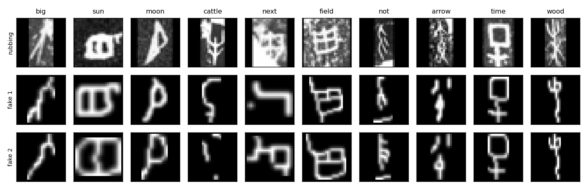

(a) shallow、ReLU、5.3 的前處理、CE、batch 64、Adam lr 固定 1e-3。Adam 的 weight_decay=λ 是在梯度上加 λw，等於 loss 加 (λ/2)‖w‖²。

- **搜尋空間：** λ ∈ {0, 1e-4, 3e-4, 1e-3, 3e-3, 1e-2, 3e-2, 1e-1}，8 個設定。
- **選法：** 每個設定最多 200 epochs，取 validation macro-F1 最高的 epoch 代表它，λ 和 epoch 數一起選。

選到 λ=1e-3、164 epochs，validation macro-F1 = 0.712。

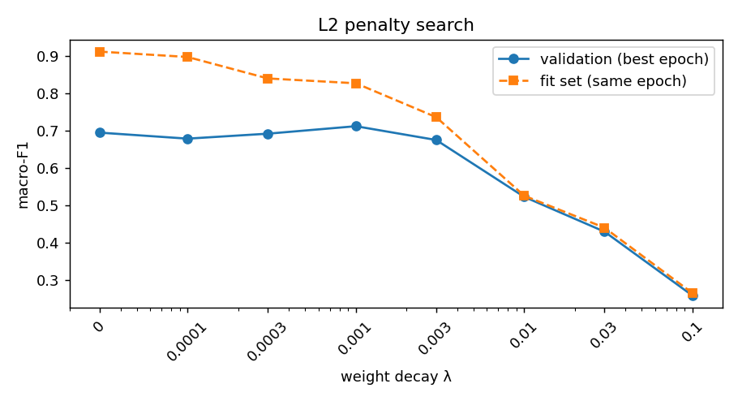

| 選定設定 | Acc | Macro-P | Macro-R | Macro-F1 | arrow | time | wood | 稀有平均 |
| --- | --- | --- | --- | --- | --- | --- | --- | --- |
| λ=1e-3、164 epochs | 0.772 | 0.744 | 0.696 | 0.712 | 0.486 (18/37) | 0.545 (12/22) | 0.538 (7/13) | 0.524 |

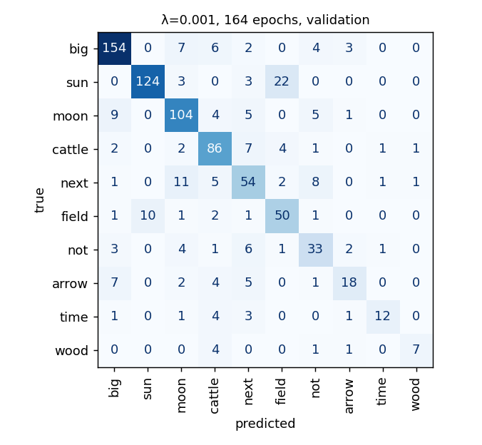

曲線形狀（fit 的分數用沒增強的原圖算）：

- **太小（λ≤3e-4）：** validation 0.68–0.70，fit 0.84–0.91。有資料增強，網路已經背不起來（4.1 沒增強時 fit 是 0.997），λw 太小，作用不明顯。
- **剛好（1e-3）：** validation 最高 0.712。主要錯誤是 sun → field 22 張、next → moon 11 張、field → sun 10 張，都是外形相近的字。
- **太大（λ≥1e-2）：** 權重被壓太小，fit 和 validation 一起掉（λ=0.1 時都只剩 0.26），是欠擬合。

(b) 用整個 training（4,160 張）重算 μ、σ，λ=1e-3、練 164 個 epoch，test 只評估這一次：

| 資料 | Acc | Macro-P | Macro-R | Macro-F1 | arrow | time | wood | 稀有平均 |
| --- | --- | --- | --- | --- | --- | --- | --- | --- |
| Validation | 0.772 | 0.744 | 0.696 | 0.712 | 0.486 (18/37) | 0.545 (12/22) | 0.538 (7/13) | 0.524 |
| Test | 0.780 | 0.708 | 0.675 | 0.686 | 0.413 (19/46) | 0.393 (11/28) | 0.562 (9/16) | 0.456 |

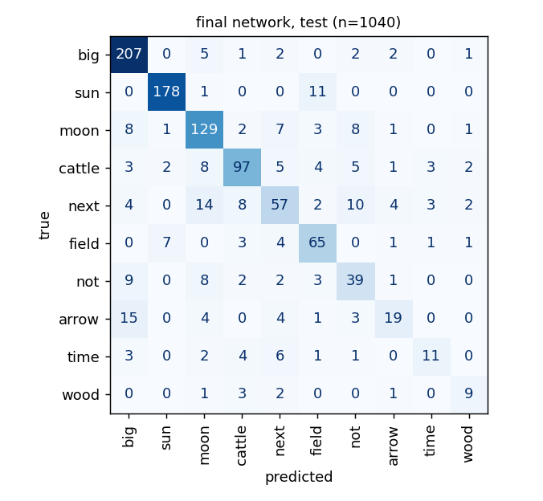

Test 的 accuracy 跟 validation 差不多（0.780 對 0.772），macro-F1 低 0.026、稀有平均低 0.067：

- **挑選偏差：** 0.712 是從 1,600 個 validation 分數（8 個 λ × 200 個 epoch）裡挑最大的，本來就偏高。
- **稀有字張數少：** test 的稀有字只有 46、28、16 張，一張 wood 就是 6%。

Test 的錯誤型態跟 validation 一樣：arrow → big 15 張、next → moon 14 張、sun → field 11 張、next → not 10 張。

## 6.2 Your own handwriting

(a) 一個規則套用到全部 30 張，不調整單張圖：

1. R、G、B 三個 channel 取平均。
2. 如果整張的平均 < 中位數（深色字、淺色紙），就反相成 255 − x，變成亮字暗底。
3. 減掉局部背景：x − grey_opening(x, 9×9)，去掉紙的底色和陰影；再除以第 99 百分位數、截在 [0, 1]，背景 = 0、筆畫 = 1。
4. 取 >0.3 的像素的外框，等比例縮放成長邊 26 px，放在 28×28 黑底中央（資料集的字也是長邊撐滿、置中）。
5. 乘 255、三個 channel 複製成一樣，存成 28×28×3 的 uint8。

之後跟訓練時一樣除以 255，再用 6.1b 的 μ、σ 標準化。

分類時，手寫字每個字都是 3 張、各類一樣多，但網路學到的是 training 的類別比例（big 是 wood 的 14 倍）。依 Bayes 定理（L5）P(C|x) ∝ P(x|C)P(C)，把 training 的 prior 換成均勻：logit − log P_train(C) 再取 argmax。網路不變，也沒有可調的參數。

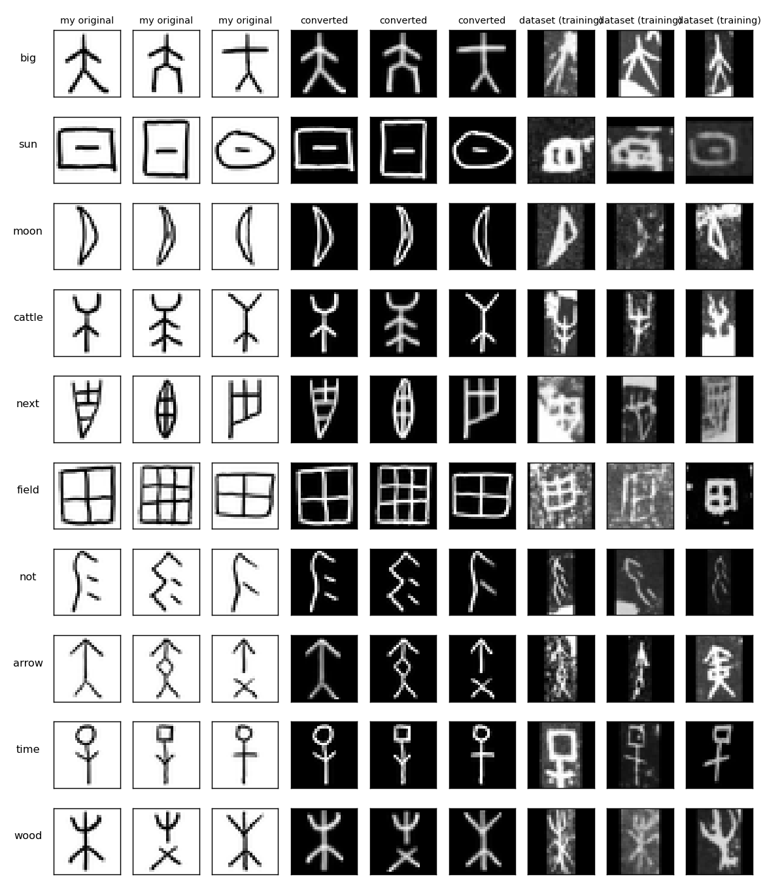

(b) 用 6.1b 的網路，不重訓：

| 字 | big | sun | moon | cattle | next | field | not | arrow | time | wood |
| --- | --- | --- | --- | --- | --- | --- | --- | --- | --- | --- |
| 答對（/3） | 3 | 3 | 3 | 1 | 2 | 3 | 3 | 3 | 3 | 2 |

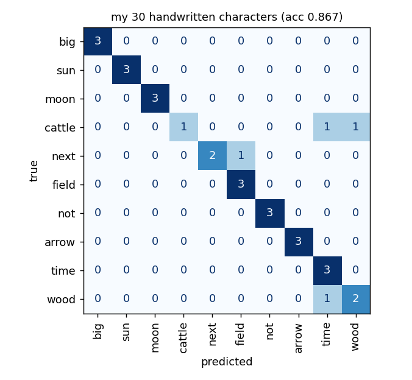

- **Accuracy：** 26/30 = 0.867，比 test 的 0.780 高。直接 argmax（不換 prior）是 21/30。
- **跟 pre-report 預測（18/30）比：** 多對 8 張。
  - 我預測主字形比較容易：不成立，主字形 9/10，兩個變體 9/10、8/10，差不多。
  - 我預測矢、巳、木最難：不成立，矢、巳全對，木 2/3；最難的是牛（1/3）。
- **錯在哪：** 4 個錯誤是 cattle → time、cattle → wood、wood → time、next → field。

(c) 我的字跟資料集比（像素值 0–255，資料集用 training 部分）：

| | 平均像素 | 像素 = 0 | 像素 > 128 | 背景（≤64）平均 | 有亮像素的欄寬 |
| --- | --- | --- | --- | --- | --- |
| 資料集 | 60.5 | 38.3% | 17.6% | 15.1 | 16.9 px |
| 我的 30 張 | 29.2 | 67.3% | 11.3% | 2.5 | 15.2 px |

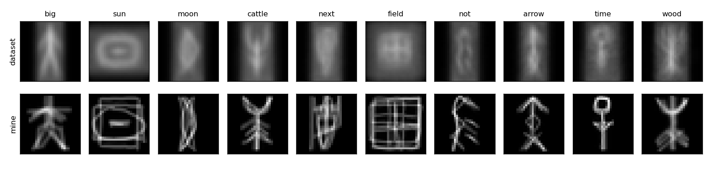

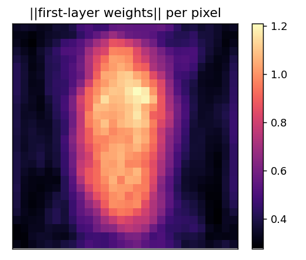

- **背景和雜訊：** 拓本背景平均 15，有裂痕斑點；我的背景幾乎純黑（2.5）。標準化後我的圖平均是 −0.49，資料集是 0。
- **筆畫粗細：** 拓本筆畫粗又模糊；我的細又乾淨，亮像素只佔 11.3%（資料集 17.6%）。
- **大小和位置：** 字寬差不多（15.2 對 16.9 px），但各類平均圖差很多：資料集每類都是一條模糊的直帶，我的是清楚的線。
- **網路怎麼用每個像素：** 第一層 z_i = Σ_j w_ij x_j，每個像素有自己的權重，不看形狀。權重圖顯示權重集中在中間的直帶，因為訓練圖兩邊多半是黑邊。所以只要筆畫落在同樣的像素上，網路就會當成同一個字。

所以會準，是因為 6.1 的假手寫讓網路在訓練時就看過黑底、細筆畫的字，上面這些差異它都見過。實驗：同樣的訓練（λ、epoch、平移縮放旋轉都一樣）但不用假手寫，我的 30 張只對 20/30，有假手寫是 26/30，跟這個解釋一致。剩下的錯都是 cattle、wood、time 互判：三個字都是一根貫穿中間的直線加上幾筆橫的，逐像素比對時重疊很多。

**Color channels：** 資料集三個 channel 一樣；我的 30 張用黑墨水，三個 channel 其實也一樣（channel 差距平均 0.000）。

- **網路怎麼處理 channel 差異：** 每個像素有 R、G、B 三個權重，但訓練圖三個 channel 永遠相同，∂L/∂w_R = ∂L/∂w_G = ∂L/∂w_B，三個權重拿到一樣的梯度，只差初始的隨機值。量到 ‖W_R − W_G‖/‖W_R‖ 從初始化的 1.415 變成 0.004，相關係數 1.000，網路等於只看三個 channel 的總和。
- **會怎麼影響準確率：** 彩色墨水會讓三個 channel 的筆畫亮度不同，例如藍墨水在 B channel 幾乎看不到，加起來的總和變弱又不均勻，準確率會掉。第 1 步先平均 channel 再拉對比就是為了這個。

實驗：把我的 30 張模擬成藍墨水（筆畫深度在 R、G、B 分別乘 0.9、0.6、0.15）：

| 輸入 | 答對 |
| --- | --- |
| 我的原圖 + 我的轉換 | 26/30 |
| 藍墨水 + 我的轉換 | 26/30 |
| 藍墨水 + 拿掉第 1 步（不平均 channel） | 22/30 |

結果符合預期：有第 1 步時 30 張的預測一張都沒變，拿掉第 1 步掉到 22/30，有 4 張的預測改變。

(d) class handwriting 的 4,320 張用同一個轉換、6.1b 的網路、均勻 prior 預測，存成 HW3_prediction_113062273.npy。
